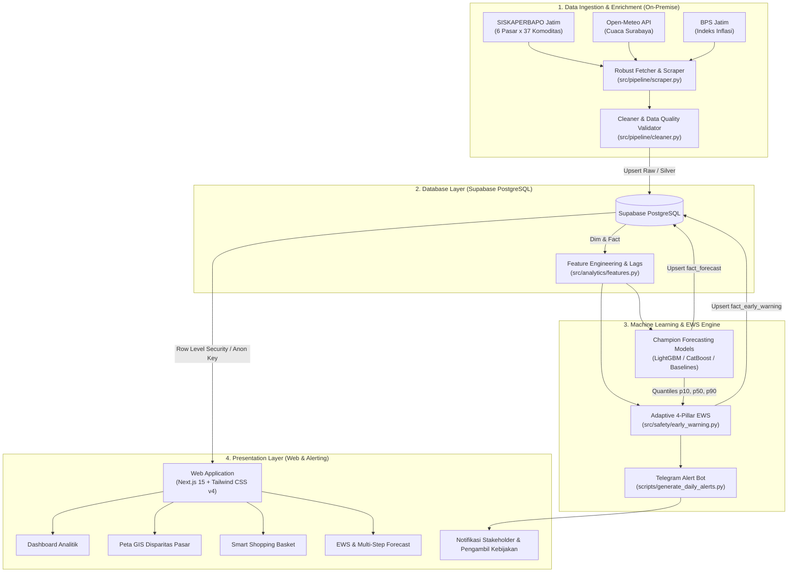

# HargaWatch Surabaya — Food Price Intelligence & Early Warning System

[](https://www.python.org/)
[](https://nextjs.org/)
[](https://react.dev/)
[](https://tailwindcss.com/)
[](https://supabase.com/)
[](https://siskaperbapo.jatimprov.go.id)
[](tests/)
[](run_pipeline.bat)

Platform intelijen harga pangan, peramalan multi-step, dan sistem peringatan dini (*Early Warning System*) berbasis AI/ML untuk Kota Surabaya. 

HargaWatch mengintegrasikan data harian pasar tradisional dari SISKAPERBAPO, cuaca historis & forecast Open-Meteo, data inflasi BPS, model peramalan quantil (GBDT & statistik), deteksi anomali data, EWS adaptif 4 pilar, alerting otomatis Telegram, serta portal web interaktif modern yang dapat diakses oleh masyarakat dan pengambil kebijakan (TPID Surabaya).

---

## 🌟 Fitur Utama Platform

### 1. Data Engineering & Pipeline Harian
* **6 Pasar Strategis Surabaya:** Wonokromo, Genteng, Pucang Anom, Tambahrejo, Soponyono, dan Pasar Induk Keputran.
* **37 Komoditas Pangan Strategis:** Beras, cabai rawit/merah, bawang merah/putih, daging ayam/sapi, telur, aneka ikan laut/tawar, minyak goreng, gula, dan sayuran.
* **Cakupan Historis Panjang:** Rekam jejak kontinu sejak Januari 2020 hingga kini (>476.000 observasi harga harian).
* **Dual-Price Architecture:** Memisahkan kolom `harga_asli` (murni transaksi fisik lapangan) dan `harga_imputasi` (kontinu tanpa bias *lookahead* untuk kebutuhan analitik/ML).
* **Fitur Transmisi Grosir (*Keputran Lead*):** Memanfaatkan harga Pasar Induk Keputran lag-1, lag-2, lag-3 sebagai sinyal dini pembentukan harga di 5 pasar retail satelit.
* **Update Otomatis On-Premise:** Scraper cerdas tahan WAF Cloudflare berjalan setiap pagi via Windows Task Scheduler.

### 2. Machine Learning & Early Warning System (EWS)
* **Champion Models per Komoditas:** Kombinasi LightGBM Quantile Regression, CatBoost, XGBoost, serta baseline statistik (*Naive Last Value*, AutoARIMA, AutoETS) yang divalidasi lewat *walk-forward backtesting*.
* **Multi-Step Quantile Trajectory ($H=1..14$):** Estimasi interval ketidakpastian harga ($p_{10}, p_{50}, p_{90}$) untuk mengantisipasi potensi lonjakan maupun penurunan harga.
* **Adaptive 4-Pillar EWS (Skor 0–100):**
  * **Pilar 1 (Tren & Momentum, 20 poin):** Kenaikan harga WoW (*week-over-week*) dan MoM (*month-over-month*) dengan ambang batas adaptif per klaster komoditas.
  * **Pilar 2 (Volatilitas Pasar, 20 poin):** Deviasi standar bergerak 7 hari dan 14 hari terhadap harga rata-rata historis.
  * **Pilar 3 (Disparitas Grosir Keputran, 20 poin):** Margin retail terhadap harga Pasar Induk Keputran serta *spatial spread* antar-pasar retail.
  * **Pilar 4 (Proyeksi Machine Learning, 40 poin):** Pelanggaran batas atas quantil $p_{90}$ dan tren kenaikan harga yang diproyeksikan model.
  * **Status Peringatan:** `NORMAL` ($<30$), `WASPADA` ($30-59$), `TINGGI` ($\ge 60$) dilengkapi fitur *plateau resilience* (mencegah amnesia risiko saat harga bertahan di tingkat tinggi).
* **Telegram Bot Dispatcher:** Pengiriman ringkasan peringatan dini secara otomatis setiap pagi ke grup pengawas/stakeholder.

### 3. Portal Web Interaktif (Next.js 15 App Router)
* **Dashboard Utama:** Ringkasan inflasi pangan lokal, harga rata-rata kota, status risiko pasar, dan tren harga harian.
* **Katalog 37 Komoditas Pangan:** Navigasi instan berdasarkan klaster (Pangan Pokok, Protein Hewani, Hortikultura/Bumbu, Ikan, Kacang/Umbi, FMCG).
* **Peta GIS Pasar Surabaya (Leaflet):** Peta persebaran 6 pasar tradisional, visualisasi disparitas spasial, serta perbandingan pasar termahal vs termurah.
* **Keranjang Belanja Pintar (*Smart Shopping Basket*):** Rekomendasi pasar paling hemat bagi keluarga berdasarkan simulasi kombinasi belanja harian.
* **Halaman Forecasting & EWS:** Grafik interaktif interval ketidakpastian harga ke depan beserta rincian 4 pilar risiko.

---

## 🏗️ Arsitektur Sistem



---

## 🗂️ Struktur Repositori

```text
hargawatch-surabaya/
├── AGENTS.md                  # Kontrak kerja & protokol operasional agent
├── README.md                  # Dokumentasi utama proyek
├── requirements.txt           # Dependensi Python backend & data science
├── run_pipeline.bat           # Entrypoint Windows Task Scheduler harian
├── config/
│   ├── commodities.json       # Metadata & taksonomi 37 komoditas pangan
│   └── config.yaml            # Parameter pipeline, model, dan direktori
├── src/
│   ├── pipeline/              # Ingestion scraper, data quality, & cleaner
│   ├── analytics/             # Feature engineering, lag generator, & spatial spread
│   ├── models/                # Machine learning forecaster (GBDT & baselines)
│   ├── safety/                # 4-Pillar Early Warning System & evaluator
│   └── utils/                 # Supabase ingest, alerting, & database helpers
├── scripts/
│   ├── run_daily_pipeline.py  # Orkestrator harian pipeline (scrape -> forecast -> alert)
│   ├── run_forecasting.py     # Script inferensi multi-step forecasting
│   └── generate_daily_alerts.py # Generator pesan & pengirim alert Telegram
├── models/
│   └── forecasting/
│       ├── registry.json      # Metadata model champion 37 komoditas
│       └── *.pkl              # Champion model artifacts
├── tests/                     # 79 unit dan stress test (deterministic pytest)
├── docs/                      # Spesifikasi teknis, PRD, dan panduan metodologi
└── web/                       # Aplikasi frontend web modern
    ├── package.json           # Dependensi Next.js 15, React 19, Tailwind CSS v4
    ├── src/
    │   ├── app/               # Next.js App Router (Dashboard, Peta, EWS, Forecast)
    │   ├── components/        # UI components (Leaflet map, charts, filters)
    │   └── lib/               # Supabase client & catalog data service
    └── AGENTS.md              # Pedoman khusus pengembangan frontend
```

---

## 📊 Skema Dataset (Supabase PostgreSQL)

| Layer | Tabel | Deskripsi |
|---|---|---|
| **Master** | `dim_pasar` | Metadata 6 pasar Surabaya beserta koordinat latitude/longitude |
| **Master** | `dim_komoditas` | Taksonomi 37 komoditas pangan, klasterisasi, dan satuan ukur |
| **Master** | `dim_kalender` | Kalender harian (2020–2026), penanda hari libur, dan periode Ramadan |
| **Silver** | `fact_harga_pasar` | Transaksi harga harian pasar (`harga_asli`, `harga_imputasi`, `flag`) |
| **Silver** | `fact_harga_produsen` | Harga tingkat produsen/grosir (PS Bendul Mrisi, RPH Pegirikan) |
| **Silver** | `fact_cuaca` | Parameter meteorologi Surabaya (curah hujan, suhu, kelembaban) |
| **Gold** | `fact_forecast` | Hasil peramalan harga multi-step horizon $H=1..14$ ($p_{10}, p_{50}, p_{90}$) |
| **Gold** | `fact_early_warning` | Skor risiko gabungan 4 pilar, status alert, dan komponen breakdown |

---

## 🚀 Panduan Memulai (*Quick Start*)

### Prasyarat
* **Python:** 3.11 atau lebih baru
* **Node.js:** v18.18 atau lebih baru (disarankan v20 LTS)
* **Akun Supabase:** Proyek Supabase PostgreSQL yang telah terkonfigurasi

---

### A. Setup Backend & Pipeline Data

1. **Clone repository dan siapkan virtual environment:**
   ```bash
   git clone https://github.com/arfisyah/hargawatch-surabaya.git
   cd hargawatch-surabaya

   # Buat dan aktifkan venv (Windows)
   python -m venv .venv
   .\.venv\Scripts\activate
   # Linux/macOS: source .venv/bin/activate
   ```

2. **Install dependensi Python:**
   ```bash
   pip install -r requirements.txt
   ```

3. **Konfigurasi Environment Variables:**
   Salin berkas contoh konfigurasi:
   ```bash
   cp .env.example .env
   ```
   Lengkapi variabel berikut di file `.env`:
   * `SUPABASE_URL` dan `SUPABASE_SERVICE_ROLE_KEY` (kunci privat untuk mutasi data pipeline harian)
   * `TELEGRAM_BOT_TOKEN` dan `TELEGRAM_CHAT_ID` (opsional, untuk penerimaan notifikasi alert)

4. **Jalankan Verifikasi Pengujian (Unit & Stress Tests):**
   ```bash
   pytest tests/ -v
   ```
   *(Seluruh 79 test suite deterministik harus lulus)*.

5. **Eksekusi Pipeline Harian Secara Manual:**
   ```bash
   python scripts/run_daily_pipeline.py
   # atau menggunakan batch script:
   run_pipeline.bat
   ```

---

### B. Setup Frontend Web (Next.js 15)

1. **Masuk ke folder `web/` dan install dependensi:**
   ```bash
   cd web
   npm install
   ```

2. **Konfigurasi Environment Web:**
   Buat file `web/.env.local` dan isi kredensial publik Supabase:
   ```env
   NEXT_PUBLIC_SUPABASE_URL=https://<your-project>.supabase.co
   NEXT_PUBLIC_SUPABASE_ANON_KEY=your-supabase-anon-or-publishable-key
   ```

3. **Jalankan Development Server:**
   ```bash
   npm run dev
   ```
   Buka peramban di [http://localhost:3000](http://localhost:3000).

4. **Verifikasi Build Produksi:**
   ```bash
   npm run build
   ```

---

## ⏰ Otomatisasi Harian (*Windows Task Scheduler*)

Karena portal SISKAPERBAPO memblokir IP server cloud publik via Cloudflare WAF (HTTP 403), ingestion harian dijalankan secara *On-Premise* di workstation lokal.

Proses otomatisasi dapat diatur melalui Task Scheduler agar mengeksekusi `run_pipeline.bat` setiap pagi (pukul 06.00 WIB):
1. Buka **Task Scheduler** di Windows.
2. Buat tugas baru (*Create Basic Task*) dengan nama `HargaWatch Daily Pipeline`.
3. Atur trigger ke **Daily** pukul `06:00 AM`.
4. Atur action ke **Start a Program**, arahkan ke path absolut berkas `run_pipeline.bat`, dan tetapkan field **Start in** ke root direktori repositori `hargawatch-surabaya`.
5. Seluruh log eksekusi harian akan tersimpan di folder `logs/`.

Panduan lengkap konfigurasi dan troubleshooting dapat dipelajari di **[`docs/panduan_operasional.md`](docs/panduan_operasional.md)**.

---

## 📚 Dokumentasi Teknis

| Dokumen | Topik Pembahasan |
|---|---|
| [`docs/ARCHITECTURE.md`](docs/ARCHITECTURE.md) | Desain arsitektur end-to-end, batas sistem, dan integrasi database |
| [`docs/PRD_HargaWatch_v2.md`](docs/PRD_HargaWatch_v2.md) | Product Requirement Document (PRD) v2, user personas, & feature specs |
| [`docs/forecasting_methodology.md`](docs/forecasting_methodology.md) | Metodologi feature engineering, evaluasi walk-forward, dan quantile GBDT |
| [`docs/EWS_methodology.md`](docs/EWS_methodology.md) | Detail kalkulasi skor 4 pilar EWS, bobot pilar, dan mitigasi plateau amnesia |
| [`docs/daftar_komoditas.md`](docs/daftar_komoditas.md) | Taksonomi lengkap 37 komoditas pangan dan mapping grup komoditas |
| [`docs/panduan_operasional.md`](docs/panduan_operasional.md) | SOP operasional, migrasi Supabase, troubleshooting, dan automasi cron |

---

## 📄 Lisensi & Kontribusi

Proyek ini dikembangkan untuk tujuan penelitian akademis dan intelijen ketahanan pangan perkotaan. Kontribusi terbuka untuk perbaikan pipeline, penajaman model peramalan, dan peningkatan fitur analitik publik.
