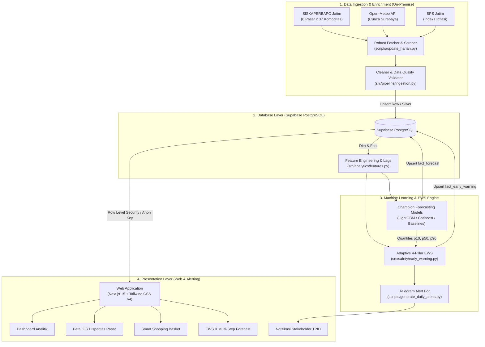

# HargaWatch Surabaya — Food Price Intelligence & Early Warning System Blueprint

[](https://www.python.org/)
[](https://nextjs.org/)
[](https://react.dev/)
[](https://tailwindcss.com/)
[](https://supabase.com/)
[](https://siskaperbapo.jatimprov.go.id)
[](tests/)
[](run_pipeline.bat)

Platform intelijen harga pangan, peramalan multi-step, dan sistem peringatan dini (*Early Warning System*) berbasis AI/ML untuk Kota Surabaya. 

HargaWatch mengintegrasikan data harian pasar tradisional dari SISKAPERBAPO, cuaca historis & forecast Open-Meteo, data inflasi BPS, model peramalan quantil (GBDT & statistik), deteksi anomali data, EWS adaptif 4 pilar, alerting otomatis Telegram, serta portal web interaktif modern yang dapat diakses oleh masyarakat dan pengambil kebijakan (TPID Surabaya).

---

## System Overview

Platform beroperasi dalam 4 lapisan arsitektural yang saling terintegrasi secara kausal:



---

## Subdirectories & System Boundaries

Setiap subsistem kode memiliki kontrak arsitektur Elephant-Goldfish Model (EGM) tersendiri:

- **`scripts/`**: [`./scripts/README.md`](./scripts/README.md) — Orkestrasi eksekutif harian, ingesti tahan WAF, auto-recovery catch-up, inferensi multi-step quantile forecasting, dispatch peringatan Telegram, dan retraining paralel multi-core.
- **`src/`**: [`./src/README.md`](./src/README.md) — Inti backend cerdas yang menaungi 5 paket modular:
  - [`src/pipeline/`](./src/pipeline/README.md): Pengambilan data pasar harian, fetcher tahan retry, imputasi forward-fill, dan DDL batch upsert.
  - [`src/models/`](./src/models/README.md): Regresi kuantil ($p_{10}, p_{50}, p_{90}$), baseline Naive Last Value, validasi walk-forward backtesting, dan deteksi anomali statistik harga.
  - [`src/safety/`](./src/safety/README.md): Matriks risiko Early Warning System 4 pilar adaptif, mitigasi plateau amnesia, dan perumusan pesan darurat Telegram.
  - [`src/utils/`](./src/utils/README.md): Pool koneksi Supabase, migrasi skema tabel DDL, validasi kualitas data, dan alerting dengan token tersanitasi.
  - [`src/analytics/`](./src/analytics/README.md): Rekayasa fitur kausal, transmisi sinyal grosir Pasar Induk Keputran, kalender Islam, dan kalkulator metrik waktu (WAPE/MAE/PICP).
- **`web/`**: [`./web/README.md`](./web/README.md) — Aplikasi frontend web Next.js 15 App Router yang menyajikan dashboard publik, visualisasi peta GIS disparitas pasar, simulasi belanja hemat, dan grafik proyeksi tren harga pangan.

---

## Global Invariants

1. **Scraping Infrastructure Sovereignty (Cloudflare WAF Block):**
   * Server SISKAPERBAPO memblokir IP datacenter cloud publik (HTTP 403 Forbidden).
   * Scraping harian wajib dieksekusi secara On-Premise via Windows Task Scheduler (`run_pipeline.bat` atau `scripts/setup_task_scheduler.ps1`). DILARANG memindahkan skrip scraping ke GitHub Actions.
2. **Zero Lookahead Temporal Causality:**
   * Tidak boleh ada kebocoran data masa depan ke dalam rekayasa fitur atau preprocessing.
   * Semua statistik bergerak (`rolling_mean`, `rolling_std`, `rolling_max`) wajib di-shift mundur (`.shift(1)`).
   * Imputasi data hilang dibatasi maksimal 7 hari maju berturut-turut: `ffill(limit=7)`. Data hilang > 7 hari tetap `NaN`.
   * Backward-fill (`bfill`) dan interpolasi terpusat dilarang keras.
3. **Wholesale Transmission Lead Indicator:**
   * Fitur transmisi harga grosir Pasar Induk Keputran wajib menggunakan data historis: `keputran_price_lag_1`, `lag_2`, `lag_3`.
4. **Adaptive EWS Plateau Amnesia Prevention:**
   * Pada krisis harga berkepanjangan dengan harga tertahan tinggi, rasio standar deviasi $std_{7d}/std_{30d}$ bisa mengecil; sistem menerapkan Z-score level trigger ($Z \ge 2.0$) agar pilar volatilitas tetap mempertahankan 20 poin risiko penuh.
5. **Database Security & Access Control:**
   * PostgreSQL Supabase menggunakan Row-Level Security (RLS).
   * Kode web client-side secara ketat hanya menggunakan anon/publishable key (`process.env.NEXT_PUBLIC_SUPABASE_ANON_KEY`). Kunci administratif `SERVICE_ROLE_KEY` hanya digunakan oleh skrip pipeline lokal.
6. **Content Security Policy (CSP) Whitelist Integrity:**
   * Origin `https://fonts.googleapis.com` dan `https://fonts.gstatic.com` wajib di-whitelist pada `web/next.config.ts`. Menghapus domain ini mematikan parsing ligatur font Google, merusak seluruh ikon visual pada antarmuka web.
7. **Credential Sanitization:**
   * `TELEGRAM_BOT_TOKEN` dan password database tidak boleh muncul di log, stdout, stderr, atau error trace. Masking otomatis diterapkan dengan label `[REDACTED_BOT_TOKEN]`.

---

## Global Side Effects

- **Supabase PostgreSQL Mutations:** Mutasi idempotent pada tabel fakta (`fact_harga_pasar`, `fact_harga_produsen`, `fact_cuaca`, `fact_forecast`, `fact_early_warning`).
- **Telegram Notification Dispatch:** Pengiriman notifikasi krisis ke bot Satgas Pangan saat komoditas berstatus `WASPADA` atau `TINGGI`.
- **OpenStreetMap CDN Requests:** Pengunduhan tile peta Leaflet dari `tile.openstreetmap.org`.
- **Local Disk I/O:** Penulisan log eksekusi harian pada folder `logs/` dan file cache lokal pada `data/processed/`.

---

## System Verification

Setiap pembaruan atau rilis wajib lulus seluruh gerbang verifikasi deterministik berikut:

### 1. Backend & Machine Learning Verification
```bash
# Aktifkan virtual environment
.venv\Scripts\activate   # Windows

# Jalankan seluruh unit dan integration test suite (79 deterministic tests)
pytest tests/ -v

# Jalankan test khusus EWS dan Forecasting Engine
pytest tests/test_ews_adaptive.py -v
pytest tests/test_forecast_engine.py -v
pytest tests/test_anomaly_detector.py -v
```

### 2. Frontend Web Verification
```bash
cd web

# 1. Verifikasi kompilasi dan rendering halaman statis (Harus sukses 8/8 halaman)
npm run build

# 2. Verifikasi linting kode Next.js
npm run lint

# 3. Verifikasi dependensi keamanan (Harus 0 kerentanan high/critical)
npm audit --audit-level=high
```

### 3. Pipeline Smoke Tests
```bash
# Smoke test peramalan dan EWS lokal (dry-run tanpa database mutation)
python scripts/run_forecasting.py --horizon 14 --local-only

# Smoke test master pipeline harian
python scripts/run_daily_pipeline.py
```

---

## Documentation Index

| Dokumen | Topik Pembahasan |
|---|---|
| [`AGENTS.md`](./AGENTS.md) | Kontrak kerja, batasan arsitektur, dan protokol verifikasi AI agent |
| [`scripts/README.md`](./scripts/README.md) | Kontrak operasional CLI skrip pipeline, parameter, dan exit codes |
| [`src/README.md`](./src/README.md) | Cetak biru arsitektur modul backend intelijen |
| [`src/pipeline/README.md`](./src/pipeline/README.md) | Kontrak scraper SISKAPERBAPO, cleaner, dan modul HTTP fetcher |
| [`src/models/README.md`](./src/models/README.md) | Kontrak model ML kuantil, baselines, backtesting, dan detektor anomali |
| [`src/safety/README.md`](./src/safety/README.md) | Kontrak sistem EWS 4 pilar, scoring krisis, dan generator alert |
| [`src/utils/README.md`](./src/utils/README.md) | Kontrak koneksi database Supabase, skema DDL, dan pembersih token |
| [`src/analytics/README.md`](./src/analytics/README.md) | Kontrak rekayasa fitur kausal, transmisi Keputran, dan metrik evaluasi |
| [`web/README.md`](./web/README.md) | Cetak biru frontend Next.js 15, kontrak komponen UI, dan data service |
| [`docs/ARCHITECTURE.md`](./docs/ARCHITECTURE.md) | Desain arsitektur end-to-end, skema Supabase, dan model boundaries |
| [`docs/PRD_HargaWatch_v2.md`](./docs/PRD_HargaWatch_v2.md) | Product Requirement Document (PRD) v2, user personas, & feature specs |
| [`docs/forecasting_methodology.md`](./docs/forecasting_methodology.md) | Metodologi rekayasa fitur, evaluasi walk-forward, dan kuantil GBDT |
| [`docs/EWS_methodology.md`](./docs/EWS_methodology.md) | Detail kalkulasi skor 4 pilar EWS, bobot pilar, dan mitigasi plateau amnesia |
| [`docs/panduan_operasional.md`](./docs/panduan_operasional.md) | SOP operasional, migrasi Supabase, troubleshooting, dan automasi cron |
