# Arsitektur Sistem HargaWatch Surabaya

Dokumen ini memetakan aliran data (*data flow*) dan batasan tanggung jawab (*separation of concerns*) untuk setiap peran dalam proyek HargaWatch.

## Diagram Arsitektur Terpadu (6-Layer Hub-and-Spoke & Pipeline Engine)

```mermaid
flowchart TB
    %% Styling Classes
    classDef source fill:#E3F2FD,stroke:#1565C0,stroke-width:2px,color:#0D47A1;
    classDef pipeline fill:#FFF8E1,stroke:#F57F17,stroke-width:2px,color:#E65100;
    classDef storage fill:#E8F5E9,stroke:#2E7D32,stroke-width:2px,color:#1B5E20;
    classDef ai fill:#EDE7F6,stroke:#512DA8,stroke-width:2px,color:#311B92;
    classDef safety fill:#FFEBEE,stroke:#C62828,stroke-width:2px,color:#B71C1C;
    classDef app fill:#E0F7FA,stroke:#00838F,stroke-width:2px,color:#006064;
    classDef user fill:#ECEFF1,stroke:#455A64,stroke-width:2px,color:#263238;

    %% 1. DATA SOURCES
    subgraph L1 ["1. LAYER SUMBER DATA EKSTERNAL (DATA INGESTION)"]
        direction LR
        S1["SISKAPERBAPO Jatim<br/>(Scraping 6 Pasar Harian)"]:::source
        S2["Open-Meteo ERA5 API<br/>(Curah Hujan & Suhu Surabaya)"]:::source
        S3["BPS Jatim / Surabaya<br/>(IHK & Inflasi Bulanan)"]:::source
        S4["Data Hulu Produsen<br/>(RPH Pegirikan & PS Bendul Mrisi)"]:::source
        S5["Dimensi Kalender & Agama<br/>(Pra-Ramadan, Idulfitri, Libur)"]:::source
    end

    %% 2. DATA PIPELINE & SILVER STORAGE
    subgraph L2 ["2. LAYER PIPELINE DATA & REKAYASA FITUR (SILVER LAYER)"]
        direction TB
        subgraph ETL ["Ingestion & Preprocessing Engine"]
            P1["Daily Cron Scraper<br/>(scripts/update_harian.py)"]:::pipeline
            P2["Catch-up Auto Recovery<br/>(scripts/update_catchup.py)"]:::pipeline
            P3["Data Cleaning Pipeline<br/>(ffill limit=7, Zero Lookahead)"]:::pipeline
        end
        
        subgraph DB_SILVER ["Supabase PostgreSQL (Silver Tables)"]
            T1[("dim_pasar & dim_komoditas<br/>(6 Pasar & 37 Komoditas)")]:::storage
            T2[("fact_harga_pasar<br/>(482k+ Baris Transaksi)")]:::storage
            T3[("fact_harga_produsen, cuaca, inflasi")]:::storage
        end
        
        FE["Feature Engineering Engine (src/analytics/features.py)<br/>• Lag Prices (1, 2, 3, 7, 14d) • Rolling Stats (7, 14, 30, 90d)<br/>• Transmisi Keputran (Lag 1-3d) • Kalender Islam (Pra-Ramadan)"]:::pipeline
    end

    S1 --> P1
    S2 --> P1
    S3 --> P1
    S4 --> P1
    S5 --> P1
    P1 --> P3
    P2 --> P3
    P3 --> DB_SILVER
    DB_SILVER --> FE

    %% 3. AI & MLOPS ENGINE
    subgraph L3 ["3. LAYER PERAMALAN AI & MLOPS ENGINE (GOLD LAYER)"]
        direction TB
        subgraph TIERED ["Arsitektur Peramalan Berjenjang (Two-Tier Forecasting Framework)"]
            M1["TIER 1: Baseline-Driven Robust (30 Komoditas)<br/>(Naive Last Value & SMA-7d)<br/>Beras, Minyak, Gula, Daging, Perikanan, FMCG"]:::ai
            M2["TIER 2: ML-Enhanced Specialized GBDT (7 Komoditas)<br/>(CatBoost & XGBoost Kuantil p10, p50, p90)<br/>Cabai Rawit, Cabai Besar, Cabai Keriting, Bawang Merah, Tomat, Buncis, Telur"]:::ai
        end

        subgraph VALIDATION ["Validasi, Kalibrasi & Model Registry"]
            V1["Walk-Forward Backtesting & Monotone Rearrangement<br/>(Rolling Origin Causal Cutoff)"]:::ai
            V2["Model Registry & Export<br/>(models/forecasting/*.pkl & registry.json)"]:::ai
            V3["Weights & Biases (W&B)<br/>(Eksperimen & Tracking MLOps)"]:::ai
        end
    end

    FE --> M1
    FE --> M2
    M1 <--> V1
    M2 <--> V1
    V1 --> V2
    V2 <--> V3

    %% 4. SAFETY & EARLY WARNING SYSTEM
    subgraph L4 ["4. LAYER SISTEM PERINGATAN DINI & OBSERVABILITAS (EWS)"]
        direction TB
        EWS["Mesin Skor Komposit EWS 100-Poin (src/safety/early_warning.py)<br/>┌───────────────────────────────────────────────┐<br/>│ • Pilar 1: Tren Historis 7-Hari     (20 Poin) │<br/>│ • Pilar 2: Rasio Volatilitas 7d/30d (20 Poin) │<br/>│ • Pilar 3: Disparitas Keputran      (20 Poin) │<br/>│ • Pilar 4: Proyeksi Bahaya ML       (40 Poin) │<br/>└───────────────────────────────────────────────┘"]:::safety
        
        STATUS["Klasifikasi Status Risiko<br/>🟢 NORMAL (<40) | 🟡 WASPADA (40-69) | 🔴 SIAGA TINGGI (>=70)"]:::safety
        
        subgraph DISPATCH ["Distribusi Peringatan"]
            TG["Telegram Alert Dispatcher<br/>(src/safety/alert_generator.py)"]:::safety
            DB_GOLD[("Supabase Gold Tables<br/>• fact_prediksi_harga<br/>• fact_early_warning")]:::storage
        end
    end

    M1 --> EWS
    M2 --> EWS
    EWS --> STATUS
    STATUS --> TG
    STATUS --> DB_GOLD
    M1 --> DB_GOLD
    M2 --> DB_GOLD

    %% 5. APPLICATION LAYER
    subgraph L5 ["5. LAYER APLIKASI WEB & DASHBOARD (FRONTEND)"]
        direction TB
        NEXT["Web Application (Next.js 15 + Tailwind CSS + Leaflet Maps)<br/>Hosted on Vercel Serverless Edge Network"]:::app
        
        subgraph MODULES ["Modul Antarmuka Pengguna"]
            U1["Peta Interaktif 6 Pasar<br/>(Sebaran Spasial & Komoditas)"]:::app
            U2["Forecasting Dashboard<br/>(Pita Interval Kuantil p10-p50-p90)"]:::app
            U3["Early Warning Center<br/>(Status Krisis & Rekomendasi Aksi)"]:::app
        end
        NEXT --> MODULES
    end

    DB_GOLD -- "Query Real-time API (@supabase/supabase-js)" --> NEXT
    DB_SILVER -- "Query Master Data" --> NEXT

    %% 6. END USERS
    subgraph L6 ["6. LAYER PENGGUNA AKHIR (STAKEHOLDERS)"]
        direction LR
        USR1["Masyarakat Umum & Konsumen"]:::user
        USR2["Pedagang Pasar & UMKM Kuliner"]:::user
        USR3["Satgas Pangan & TPID Pemkot Surabaya<br/>(Intervensi Operasi Pasar Murah)"]:::user
    end

    MODULES --> USR1
    MODULES --> USR2
    MODULES --> USR3
    TG -- "Notifikasi Darurat Pangan" --> USR3
```




## Pembagian Tanggung Jawab (Separation of Concerns)

1. **Famos (Data Engineer):** Mengelola ekstraksi data dari sumber eksternal, membersihkan data yang kotor, dan menyimpannya ke tabel *Silver Layer* (`fact_harga_pasar`).
2. **Arfi (Data Scientist / ML Engineer):** Murni membaca data historis dari *Silver Layer*, menjalankan komputasi *Forecasting* dan *Anomaly Detection*, lalu menyimpan hasilnya kembali ke *Gold Layer* (`fact_forecast`, `fact_early_warning`).
3. **Kayla (Data Analyst / Frontend Developer):** Merakit UI web menggunakan **Next.js** dan mengambil data (*read-only*) dari Supabase untuk visualisasi yang interaktif.

## Database Schema (Core Tables)

### Silver Layer
- `dim_pasar`: Data master 6 pasar (id, nama, lokasi).
- `dim_komoditas`: Data master 37 komoditas (id, nama, satuan).
- `dim_kalender`: Data dimensi waktu, libur nasional, dan bulan Ramadan.
- `fact_harga_pasar`: Tabel harga harian (observasi aktual harga_asli dan harga_imputasi).
- `fact_harga_produsen`: Tabel harga historis dari tingkat produsen.
- `fact_cuaca`: Data historis cuaca harian Surabaya (suhu, curah hujan) dari Open-Meteo.
- `fact_inflasi`: Data riwayat inflasi bulanan Kota Surabaya dari BPS.

### Gold Layer (ML Targets)
- `fact_forecast`: Menyimpan hasil ramalan harga jangka pendek (7-14 hari ke depan). Memiliki batas bawah, batas tengah, dan batas atas.
- `fact_early_warning`: Menyimpan status anomali harga komposit (NORMAL, WASPADA, TINGGI).

## Struktur Direktori Proyek

```text
hargawatch-surabaya/
│
├── data/                           # 📂 Penyimpanan data lokal (diabaikan git)
│   ├── raw/                        # Data mentah dari API / scraping SISKAPERBAPO
│   ├── processed/                  # Data bersih & terstandardisasi (Silver Layer lokal)
│   └── external/                   # Data pendukung (cuaca, inflasi, kalender)
│
├── models/                         # 🤖 Artefak model ML yang sudah dilatih (.pkl / .pt)
│   ├── forecasting/                # Model prediksi time-series
│   └── anomaly_detection/          # Model deteksi anomali harga
│
├── notebook/                       # 🧪 Eksplorasi & eksperimen per komoditas (Jupyter Notebook)
│
├── src/                            # 💻 KODE INTI (Modul Python yang dapat diimpor)
│   ├── pipeline/                   # Data Pipeline: scraping, download, preprocessing
│   │   ├── scrape_data.py          # Scraper harga konsumen dari SISKAPERBAPO
│   │   ├── scrape_produsen.py      # Scraper harga produsen
│   │   ├── download_cuaca.py       # Pengambil data cuaca dari Open-Meteo
│   │   ├── download_inflasi_bps.py # Pengambil data inflasi dari BPS
│   │   ├── preprocessing_final.py  # Pembersih, imputasi ffill limit=7, normalisasi
│   │   └── fetcher.py              # HTTP client dengan retry, jitter, & timeout
│   │
│   ├── analytics/                  # Logika Analitik & Feature Engineering
│   │   ├── features.py             # Feature engineering time-series & kalender Ramadan
│   │   └── metrics.py              # Error Analysis Toolkit (WAPE, PICP, Directional Accuracy)
│   │
│   ├── models/                     # Logika Pemodelan Machine Learning
│   │   ├── models.py               # Definisi model GBDT (CatBoost, XGBoost, LightGBM) & Baseline
│   │   ├── backtest.py             # Walk-forward rolling-origin backtesting engine
│   │   ├── forecast_engine.py      # Engine forecasting multi-horizon & monotone rearrangement
│   │   └── anomaly_detector.py     # Deteksi anomali lonjakan & disparitas harga pasar
│   │
│   ├── safety/                     # Sistem Peringatan Dini (Early Warning System)
│   │   ├── early_warning.py        # Composite scoring 4-pilar: Normal / Waspada / Siaga Tinggi
│   │   └── alert_generator.py      # Generator teks narasi peringatan krisis pasar Markdown
│   │
│   └── utils/                      # Fungsi Pembantu Umum
│       ├── ingest_supabase.py      # Koneksi & DDL Supabase PostgreSQL
│       ├── setup_ml_tables.py      # Setup tabel Gold Layer (fact_forecast, fact_early_warning)
│       ├── tambah_kalender.py      # Generator dim_kalender (libur nasional, Ramadan)
│       └── utils_alerting.py       # Wrapper pengiriman notifikasi Bot Telegram
│
├── scripts/                        # ⚙️ Entry Points / Eksekutor (Runner Scripts)
│   ├── run_daily_pipeline.py       # Master runner harian (scraping -> forecast -> alerting)
│   ├── run_unified_retraining.py   # Retraining terpadu 37 komoditas & ekspor model champion
│   ├── update_harian.py            # Cron job harian: scrape + upsert ke Supabase
│   ├── update_catchup.py           # Auto-recovery tanggal bolong di database
│   ├── run_forecasting.py          # Pipeline peramalan harian & EWS scoring
│   ├── generate_daily_alerts.py    # Evaluasi risiko & dispatch notifikasi Telegram
│   └── run_wandb_experiment.py     # Tracker eksperimen ML ke Weights & Biases
│
├── config/                         # 🛠️ Konfigurasi Sistem
│   ├── config.yaml                 # Konfigurasi database, pipeline, & threshold EWS
│   └── commodities.json            # Master mapping 37 komoditas & champion model
│
├── tests/                          # 🧪 Pengujian Otomatis (Pytest)
│   ├── conftest.py                 # Fixtures & data sintetis untuk pengujian
│   ├── test_alerting.py            # Uji notifikasi Telegram & alert generator
│   ├── test_data_quality.py        # Uji kualitas data (ffill, outlier, kalender)
│   ├── test_early_warning.py       # Uji logika skor 4-pilar Normal/Waspada/Tinggi
│   ├── test_ml_features.py         # Uji feature engineering (zero lookahead bias)
│   ├── test_ml_models.py           # Uji model forecasting (baseline, CatBoost, XGBoost)
│   └── test_pipeline_integration.py # Uji koneksi Supabase & skema tabel
│
├── web/                            # 🌐 Frontend Dashboard (Next.js 15 + Tailwind CSS v4)
│   └── src/
│       ├── app/                    # Halaman: /, /peta, /forecasting, /early-warning
│       ├── components/             # UI: SmartShoppingBasket, Header, Footer, dll
│       ├── data/                   # Mock data cadangan pengembangan
│       └── lib/                    # Supabase client & data service
│
├── docs/                           # 📖 Dokumentasi Proyek
│   ├── ARCHITECTURE.md             # (File ini) Peta arsitektur & struktur direktori
│   ├── PRD_HargaWatch_v2.md        # Product Requirements Document (Production v2.0)
│   ├── forecasting_methodology.md  # Metodologi Two-Tier Forecasting & Monotone Rearrangement
│   ├── EWS_methodology.md          # Metodologi Adaptive Early Warning System (4-Pilar)
│   ├── klasifikasi_hasil_forecasting.md # Hasil benchmark performa 37 komoditas
│   ├── panduan_operasional.md      # SOP operasional harian & Task Scheduler
│   └── daftar_komoditas.md         # Master 37 komoditas pantauan
│
├── AGENTS.md                       # Kontrak operasional & aturan kerja AI Agent
├── README.md                       # Dokumentasi utama proyek & ringkasan arsitektur
├── requirements.txt                # Semua dependensi (backward compatibility)
├── requirements-pipeline.txt       # Dependensi khusus data pipeline
└── requirements-ml.txt             # Dependensi khusus machine learning
```

## Strategi Deployment (On-Premise)
Data pipeline dan ML Pipeline dijalankan melalui **Windows Task Scheduler (On-Premise)** menggunakan skrip batch `run_pipeline.bat` setiap pagi hari. Keputusan on-premise (laptop/PC) diambil untuk menghindari pemblokiran *Cloudflare Web Application Firewall (WAF)* pada API Siskaperbapo Jatim jika diakses dari IP Data Center (seperti AWS, DigitalOcean, atau GitHub Actions). Dashboard Web tetap di-*hosting* publik (Vercel) dengan menarik data dari Supabase.
