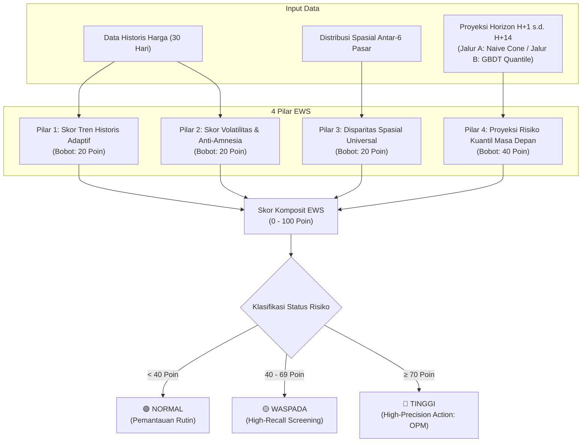
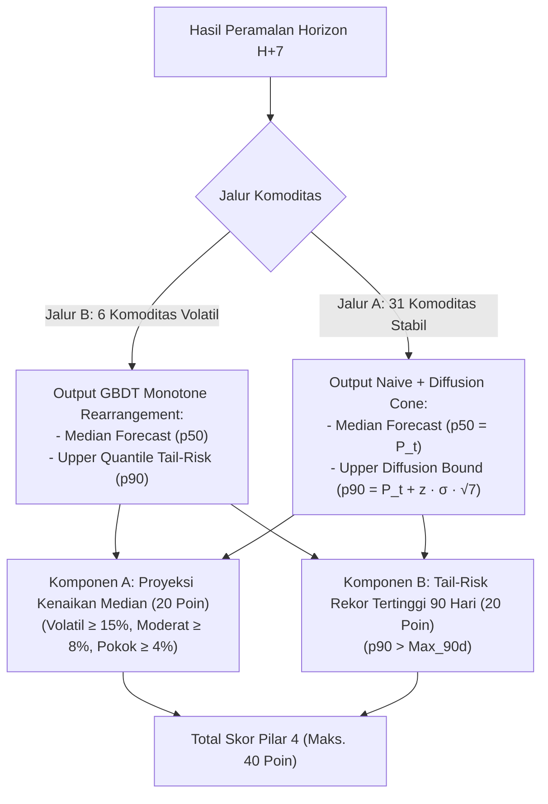

# Metodologi Early Warning System (EWS) Adaptif — HargaWatch Surabaya
## Sistem Deteksi Dini Lonjakan Harga Pangan Berbasis Skor Komposit Multi-Pilar

> **Status Dokumen:** Produksi / Aktif  
> **Ruang Lingkup:** 37 Komoditas Pangan Aktif di 6 Pasar Tradisional Kota Surabaya  
> **Pembaruan Terakhir:** Oktober 2026 (Sinkronisasi Arsitektur Two-Tier Forecasting & Protokol Data Nihil)

---

## 1. Pendahuluan & Filosofi Desain EWS

Tujuan utama sistem *Early Warning System* (EWS) HargaWatch Surabaya bukanlah memprediksi nominal harga tunggal, melainkan **menerjemahkan dinamika spasial pasar, momentum volatilitas, dan estimasi kuantil ketidakpastian masa depan ke dalam sinyal peringatan operasional (NORMAL, WASPADA, TINGGI)**. Sinyal ini dirancang secara adil dan objektif untuk seluruh **37 komoditas pangan aktif** yang dipantau di 6 pasar tradisional Kota Surabaya (Pasar Wonokromo, Genteng, Tambahrejo, Pucang Anom, Pabean, dan Pasar Induk Keputran).

### Prinsip Operasional EWS:
1. **Objektivitas Terukur:** Menggunakan sistem penilaian deterministik (0–100 poin) yang dapat diaudit, bebas dari penilaian subjektif surveyor lapangan.
2. **Sensitivitas Bertingkat (*Adaptive Thresholds*):** Mencegah fenomena kejenuhan alarm (*alarm fatigue*) pada komoditas sayuran yang wajar berfluktuasi harian, sembari tetap menjaga sensitivitas tinggi terhadap bahan pokok inelastis seperti beras dan minyak goreng.
3. **Pencegahan Alarm Palsu (*False Positive Suppression*):** Mengisolasi pasar atau lapak yang mengalami kekosongan pasokan lebih dari 7 hari (`STOK_NIHIL`) agar tidak memicu alarm palsu akibat data beku.
4. **Waktu Ancang-Ancang Kebijakan (*Actionable Lead Time*):** Memberikan sinyal bahaya **5 hingga 7 hari (H+7)** sebelum puncak krisis harga terjadi, memberikan jendela waktu yang cukup bagi Tim Pengendali Inflasi Daerah (TPID) Surabaya dan Satgas Pangan untuk menggelar intervensi Operasi Pasar Murah (OPM).

---

## 2. Arsitektur Skor Komposit Multi-Pilar (0 – 100 Poin)

Sistem EWS menghitung **Skor Komposit Risiko** secara harian per pasangan (pasar, komoditas) berdasarkan 4 pilar utama dengan bobot tetap:

---

### Pilar 1: Skor Tren Historis Adaptif (Bobot 20 Poin)
Mengukur momentum laju inflasi harga jangka pendek selama 7 hari terakhir (`pct_change_7d`):
$$\Delta P_{7d} = \frac{P_t - P_{t-7}}{P_{t-7}} \times 100\%$$

Ambang batas skor dikalibrasi secara adaptif berdasarkan elastisitas harga permintaan (*price elasticity of demand*) dan koefisien variasi historis komoditas:

| Klaster Komoditas | Daftar Komoditas Relevan | Ambang 20 Poin | Ambang 10 Poin | Justifikasi Domain & Ekonomi |
|:---|:---|:---:|:---:|:---|
| **Volatil (Hortikultura)** | Cabai Rawit, Cabai Merah Besar, Cabai Keriting, Bawang Merah, Tomat, Buncis | **$\ge 15.0\%$** | **$\ge 8.0\%$** | Mencegah *alarm fatigue* pada komoditas sayuran segar yang secara natural rentan cuaca harian. |
| **Moderat & Musiman** | Daging Ayam Ras, Telur Ayam, Bawang Putih, Kentang, Wortel, Ikan Tongkol/Bandeng | **$\ge 8.0\%$** | **$\ge 4.0\%$** | Peka terhadap gangguan siklus pakan ternak (jagung/konsentrat) atau pasokan impor. |
| **Bahan Pokok / HET / Inelastis** | Beras Premium/Medium, Minyakita, Gula Pasir, Tepung Terigu, Daging Sapi | **$\ge 4.0\%$** | **$\ge 2.0\%$** | Pangan pokok sangat inelastis; kenaikan beras 4% ($\approx$ Rp 600/kg) memicu guncangan daya beli masyarakat secara langsung. |

---

### Pilar 2: Skor Volatilitas Dinamis & Anti-Amnesia Plateau (Bobot 20 Poin)
Mengatasi kelemahan sistem EWS konvensional yang kerap mengalami *"amnesia krisis"*—ketika harga bertahan mahal di puncak krisis (*plateau*) selama berminggu-minggu, laju perubahan harga harian melandai menjadi 0% sehingga alarm bahaya mati secara prematur.

Pilar 2 menerapkan mekanisme **Pemicu Ganda (*Dual-Trigger*)**:
1. **Rasio Volatilitas Dinamis ($\text{Ratio}_{\text{vol}}$):**
   $$\text{Ratio}_{\text{vol}} = \frac{\sigma_{7d}}{\sigma_{30d} + \epsilon}$$
   Mengukur apakah fluktuasi sepekan terakhir mengalami akselerasi abnormal dibanding rata-rata bulanan.
2. **Z-Score Level Harga Historis ($Z_{\text{level}}$):**
   $$Z_{\text{level}} = \frac{P_t - \mu_{30d}}{\sigma_{30d} + \epsilon}$$
   Mengukur seberapa jauh harga saat ini berada di atas distribusi rata-rata 30 hari terakhir.

**Skema Penilaian Pilar 2:**
* **Skor 20 Poin:** Terpenuhi jika $\text{Ratio}_{\text{vol}} \ge 1.5$ **ATAU** $Z_{\text{level}} \ge 2.0\sigma$.
* **Skor 10 Poin:** Terpenuhi jika $\text{Ratio}_{\text{vol}} \ge 1.1$ **ATAU** $Z_{\text{level}} \ge 1.2\sigma$.
* **Mekanisme Anti-Amnesia:** Saat awal lonjakan krisis, $\text{Ratio}_{\text{vol}}$ menyala. Ketika krisis berkepanjangan dan harga flat tinggi di puncak, $Z_{\text{level}}$ tetap menyala menjaga alarm tetap aktif sampai harga benar-benar turun ke batas normal.

---

### Pilar 3: Skor Disparitas Spasial Universal (Bobot 20 Poin)
Mengukur ketegangan transmisi harga antar-pasar di Kota Surabaya. Pilar ini menerapkan pendekatan hibrida:

1. **Untuk Komoditas yang Tercatat di Pasar Induk Keputran (Hortikultura Grosir):**
   Mengukur penipisan marjin grosir terhadap harga eceran kota:
   $$\text{Margin}_{\text{eceran-grosir}} = \frac{P_{\text{eceran}} - P_{\text{keputran}}}{P_{\text{eceran}}} \times 100\%$$
   - Jika $\text{Margin} < 5.0\% \to$ **20 Poin** (Indikasi kelangkaan parah di tingkat grosir hulu yang belum tertransmisi penuh ke eceran).
   - Jika $\text{Margin} \le 10.0\% \to$ **10 Poin**.
2. **Untuk Komoditas Non-Keputran (Beras, Minyak, Gula, Daging, Ikan, FMCG):**
   Mengukur **Sebaran Spasial Antar-Pasar Surabaya (*Spatial Price Spread*)** melintasi 6 pasar:
   $$\text{Spread} = \frac{P_{\text{max}} - P_{\text{min}}}{P_{\text{mean}}} \times 100\%$$
   - Jika $\text{Spread} \ge 15.0\% \to$ **20 Poin** (Indikasi fragmentasi rantai pasok lokal atau penimbunan komoditas di wilayah tertentu).
   - Jika $\text{Spread} \ge 8.0\% \to$ **10 Poin**.

---

### Pilar 4: Skor Proyeksi Risiko Kuantil Masa Depan (Bobot 40 Poin)
Pilar 4 merupakan pilar paling dominan yang mengonsumsi hasil keluaran dari **Pipeline Forecasting Dua Jalur (Two-Tier Forecasting Framework)** pada horizon jangkar mingguan **$H+7$** (7 hari ke depan):

1. **Komponen A — Proyeksi Kenaikan Tren Masa Depan (Bobot 20 Poin):**
   Dihitung berdasarkan persentase perubahan median proyeksi di $H+7$ terhadap harga aktual saat ini:
   $$\Delta \hat{P}_{H+7} = \frac{\hat{y}_{t+7|t}^{(p50)} - P_t}{P_t} \times 100\%$$
   - **Klaster Volatil:** $\Delta \hat{P}_{H+7} \ge 15.0\%$ (20 pt) atau $\ge 8.0\%$ (10 pt).
   - **Klaster Moderat:** $\Delta \hat{P}_{H+7} \ge 8.0\%$ (20 pt) atau $\ge 4.0\%$ (10 pt).
   - **Klaster Pokok / HET:** $\Delta \hat{P}_{H+7} \ge 4.0\%$ (20 pt) atau $\ge 2.0\%$ (10 pt).

2. **Komponen B — Risiko Ekor Rekor Tertinggi 90 Hari (*Tail-Risk Peak*) (Bobot 20 Poin):**
   Mengevaluasi batas atas interval ketidakpastian kuantil $p_{90}(H+7)$ terhadap harga maksimum historis 3 bulan terakhir ($\text{Max}_{90d}$):
   $$\text{Kondisi Tail-Risk}: p_{90}(t+7) > \max_{i \in [0, 89]} P_{t-i}$$
   Jika terpenuhi $\to$ **20 Poin**. Mekanisme ini memastikan sistem dapat mendeteksi potensi lonjakan ekstrem (*black swan price shocks*) meskipun median prediksi masih bergerak moderat.

---

## 3. Penanganan Pasar & Komoditas Tidak Aktif (`STOK_NIHIL`)

Untuk menjaga integritas operasional, sistem EWS menerapkan protokol penanganan ketiadaan data:
1. **Deteksi Absensi Transaksi:** Jika suatu komoditas di pasar tertentu tidak mencatat harga transaksi valid selama $>7$ hari berturut-turut pada tanggal inferensi, entitas tersebut diklasifikasikan sebagai **`STOK_NIHIL / DATA_TIDAK_TERSEDIA`**.
2. **Bypass Komputasi EWS:** Entitas yang berstatus `STOK_NIHIL` **dikecualikan dari perhitungan skor EWS** dan tidak diberikan status NORMAL, WASPADA, maupun TINGGI.
3. **Pencegahan Distorsi Antar-Pasar:** Pada Pilar 3 (Disparitas Spasial), pasar yang berstatus `STOK_NIHIL` secara otomatis dikeluarkan dari perhitungan $P_{\text{max}}$, $P_{\text{min}}$, dan $P_{\text{mean}}$ agar tidak mendistorsi nilai sebaran spasial pasar yang aktif beroperasi.

---

## 4. Matriks Status Risiko & Standar Operasional Prosedur (SOP)

Total skor komposit ($0 - 100$ poin) diklasifikasikan ke dalam 3 status peringatan dengan panduan tindakan bagi TPID Surabaya:

| Status Risiko | Rentang Skor | Karakteristik Dinamika Pasar | Rekomendasi Operasional Satgas Pangan & TPID Kota Surabaya |
| :---: | :---: | :---| :---|
| 🟢 **NORMAL** | **0 – 39 Poin** | Pasokan stabil, fluktuasi harga harian dalam batas wajar, marjin distribusi normal. | **Pemantauan Pasif:** Pemantauan data harian rutin; tidak diperlukan intervensi intervensi pasar fisik. |
| 🟡 **WASPADA** | **40 – 69 Poin** | Terindikasi gejala awal ketidakseimbangan pasokan, lonjakan volatilitas, atau disparitas spasial lokal. | **High-Recall Screening (Siaga 1):** 1. Verifikasi stok fisik di gudang distributor dan Pasar Induk Keputran. 2. Cek kesiapan cadangan beras/gula Bulog Cabang Surabaya. 3. Siapkan rute logistik armada intervensi harga. |
| 🔴 **TINGGI** | **70 – 100 Poin** | Lonjakan harga terkonfirmasi multi-pilar (level harga ekstrem disertai konfirmasi proyeksi model $H+7$). | **High-Precision Intervention (Aksi Cepat):** 1. Rapat koordinasi darurat TPID Kota Surabaya. 2. **Gelar Operasi Pasar Murah (OPM)** terfokus pada pasar dengan skor disparitas tertinggi. 3. Fasilitasi subsidi ongkos angkut distribusi dari sentra produksi Jawa Timur. |

---

## 5. Metrik Evaluasi & Validasi Kinerja EWS

Kinerja EWS diuji secara empiris melalui pengujian historis (*historical backtesting*) pada periode lonjakan harga besar (misalnya fenomena El Niño akhir 2023 dan krisis cabai Idulfitri 2024–2025):

1. **Tingkat Tangkap Krisis (*Crisis Recall Rate*):**
   $$\text{Recall} = \frac{\text{True Positive Alarms}}{\text{True Positive Alarms} + \text{False Negatives}} \ge 90\%$$
   Target: Sistem wajib menangkap minimal 90% dari seluruh kejadian lonjakan harga ekstrem historis pada status WASPADA.
2. **Tingkat Alarm Palsu (*False Alarm Rate - FAR*):**
   $$\text{FAR} = \frac{\text{False Positive Alarms}}{\text{Total Alarms (Tinggi)}} \le 25\%$$
   Target: Status TINGGI harus memiliki presisi tinggi agar otoritas kota tidak menggelar operasi pasar yang sia-sia saat harga tidak benar-benar melonjak.
3. **Waktu Ancang-Ancang (*Lead Time*):**
   Target: Peringatan pertama (WASPADA/TINGGI) harus muncul **minimal 5 hingga 7 hari** sebelum puncak harga tercapai di pasar eceran.

---

## 6. Referensi & Landasan Regulasi

1. **Bank Indonesia & Kemendag RI.** (2020). *Pedoman Pengendalian Inflasi Daerah: Penguatan Early Warning System Komoditas Pangan*. Jakarta.
2. **FAO.** (2021). *Methodological Note on the Indicator of Food Price Anomalies (IFPA)*. Food and Agriculture Organization Statistics Division, Rome.
3. **Martins-Filho, C., Torero, M., & Yao, F.** (2018). *A non-parametric extreme value approach for early warning of food price shocks*. International Food Policy Research Institute (IFPRI) Discussion Paper 01725.
4. **Tim Pengendali Inflasi Daerah (TPID) Kota Surabaya.** (2024). *Laporan Monitoring Pasokan dan Stabilisasi Harga Pangan Strategis*. Bagian Perekonomian dan Sumber Daya Alam Kota Surabaya.

---
*Implementasi teknis: [`src/safety/early_warning.py`](file:///d:/ARFI/Kuliah/Project/project-semester5/hargawatch-surabaya/src/safety/early_warning.py).*