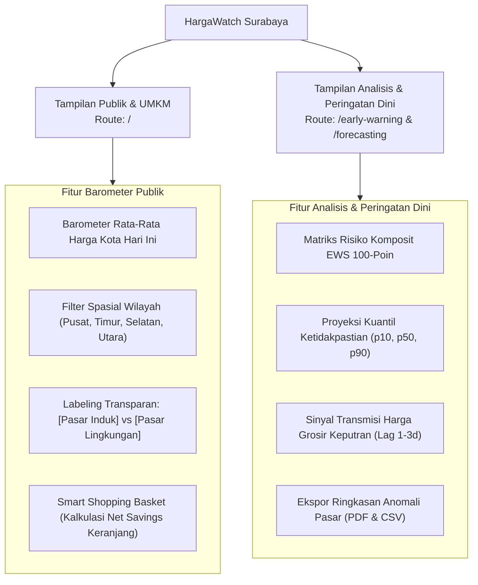
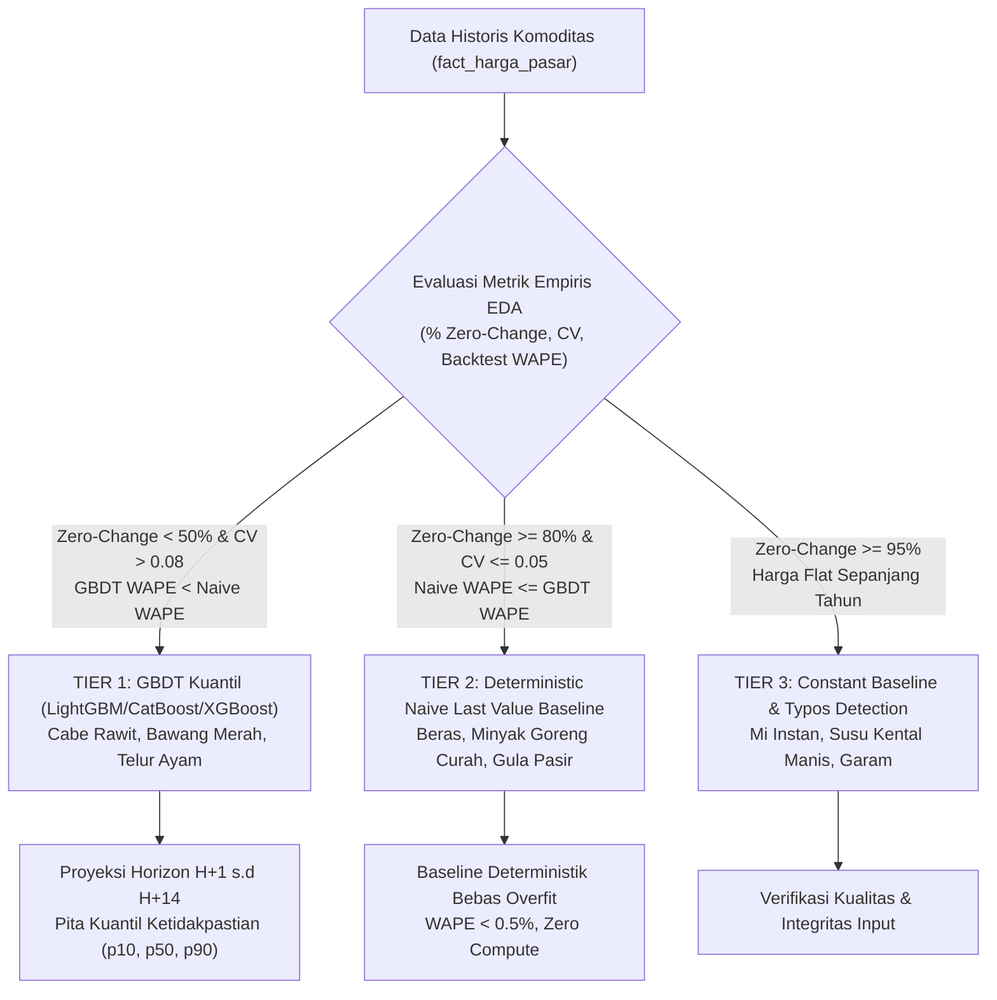

# Product Requirements Document (PRD) v2.0
## HargaWatch Surabaya: Platform Analitik Disparitas Spasial Antar-Pasar dan Deteksi Dini Volatilitas Pangan Berbasis Data Terbuka SISKAPERBAPO

> **Versi Dokumen:** 2.0 (Empirical-Driven & Inclusive Baseline)  
> **Status:** Approved / Production-Ready Specification  
> **Target Rilis:** Semester 5 Capstone / Live Production Deployment  
> **Target Stack:** Next.js 15 (React 19) + Tailwind CSS v4 + Python 3.11/3.13 ML Pipeline + Supabase PostgreSQL  
> **Dokumen Terkait:** [evaluasi_logis_proyek_hargawatch.md](file:///c:/Users/USER/.gemini/antigravity/brain/a747b00f-5253-4a65-9df7-ad9344da5d29/evaluasi_logis_proyek_hargawatch.md), [ARCHITECTURE.md](file:///d:/ARFI/Kuliah/Project/project-semester5/hargawatch-surabaya/docs/ARCHITECTURE.md), [laporan_eda_komprehensif.md](file:///d:/ARFI/Kuliah/Project/project-semester5/hargawatch-surabaya/docs/laporan_eda_komprehensif.md)

---

## 1. Visi, Posisi Produk, dan Rekonsiliasi Masalah

### 1.1 Visi Produk
HargaWatch Surabaya dibangun sebagai **sistem pendukung keputusan (*Decision Support System - DSS*)** yang menganalisis disparitas harga spasial antar-pasar di Surabaya, memproyeksikan tren harga jangka pendek, dan mendeteksi anomali harga pangan secara kuantitatif, transparan, serta dapat dimanfaatkan oleh masyarakat umum, pelaku usaha, maupun pemangku kepentingan kebijakan.

### 1.2 Pembingkaian Masalah (*Problem Framing*) yang Realistis
Berdasarkan evaluasi kritis terhadap dinamika pasar riil di Surabaya:

1. **Rasionalitas Penghematan Belanja:**
   * Konsumen rumah tangga tidak rasional jika bepergian melintasi kota (biaya BBM motor Rp 8.000–10.000) hanya demi mengejar selisih Rp 2.500 saat membeli 250 gram cabai.
   * Nilai ekonomis informasi disparitas harga antar-pasar secara riil dirasakan oleh:
     * **Pelaku Usaha Kuliner / UMKM** (warung penyetan, katering, pedagang bakso): Belanja volume 10–30 kg komoditas/hari $\implies$ potensi efisiensi biaya hingga jutaan rupiah per bulan.
     * **Smart Shopping Basket (Keranjang Mingguan Keluarga):** Akumulasi belanja mingguan beragam bahan pokok (Beras + Minyak + Telur + Daging) senilai Rp 300.000–500.000, di mana akumulasi selisih harga total keranjang (Rp 35.000–50.000) mampu melampaui biaya transportasi.
2. **Karakteristik Data Rantai Pasok Hilir (*Downstream Data Reality*):**
   * Kota Surabaya adalah **konsumen netto (*net consumer*)** dengan ketergantungan pasokan pangan $>90\%$ dari luar daerah (Kediri, Blitar, Nganjuk, Lamongan).
   * Data bersumber dari **data hilir (harga konsumen di 6 pasar)**. Sistem berfungsi memantau **transmisi gejala pergerakan harga hilir**, bukan memprediksi gagal panen di tingkat hulu.
3. **Penyajian Informasi Objektif (Tanpa Birokratisasi Berlebihan):**
   * Platform menyajikan data apa adanya sebagai alat observabilitas, analisis data, dan rujukan publik, tanpa klaim fiktif seperti pengaturan anggaran APBD atau pengendalian armada logistik fisik.

---

## 2. Arsitektur Pengguna & Fleksibilitas Antarmuka

Sistem menyajikan dua perspektif tampilan yang saling melengkapi namun inklusif bagi seluruh lapisan pengguna:

### 2.1 Penanganan Karakteristik Pasar Keputran (Transparansi, Bukan Karantina Paksa)
* **Konteks Data:** Petugas survei SISKAPERBAPO mencatat harga di Pasar Keputran dalam **satuan eceran standar (per kg)**, dan masyarakat nyata tetap bertransaksi di sana dalam skala kecil maupun besar.
* **Solusi Transparansi Pasar:**
  * Sistem **tidak menyembunyikan (*hard quarantine*)** Pasar Keputran.
  * Sebagai gantinya, sistem memberikan **label kategori pasar yang jelas**:
    * `[Pasar Induk / Grosir]` untuk Pasar Keputran.
    * `[Pasar Lingkungan / Eceran]` untuk 5 pasar lainnya (Tambahrejo, Wonokromo, Genteng, Pucang Anom, Soponyono).
  * Pengguna diberikan kebebasan menggunakan filter: opsi membandingkan seluruh pasar, atau hanya membandingkan antar-pasar lingkungan terdekat.

### 2.2 Inklusivitas Akses Fitur Peringatan Dini
* Fitur peringatan dini dirancang **inklusif untuk semua pihak**:
  * **Masyarakat umum:** Mengetahui komoditas yang diproyeksikan akan naik dalam beberapa hari ke depan agar dapat merencanakan belanja dapur lebih awal.
  * **Pelaku UMKM:** Mengantisipasi kenaikan harga bahan baku utama untuk penyesuaian porsi atau penetapan harga jual.
  * **Pemerhati / Analis Kebijakan:** Memantau pasar mana yang mengalami turbulensi ekstrem sebagai bahan telaah kebijakan intervensi pasar.

---

## 3. Ruang Lingkup Sistem (Scope Matrix)

| Komponen | In-Scope (Spesifikasi & Sasaran) | Out-of-Scope (Batasan Sistem) |
| :--- | :--- | :--- |
| **Cakupan Pasar** | 6 Pasar Resmi di Surabaya: Wonokromo, Tambahrejo, Genteng, Pucang Anom, Soponyono, dan Keputran. | Ritel modern (Supermarket/Minimarket) atau pasar liar non-resmi. |
| **Cakupan Komoditas** | Seluruh 37 komoditas pangan yang tercatat pada sistem resmi SISKAPERBAPO Surabaya. | Komoditas non-pangan atau barang impor non-kebutuhan pokok. |
| **Model Peramalan** | Arsitektur peramalan berjenjang (GBDT Kuantil untuk komoditas volatil; *Naive Baseline* untuk komoditas berpagu harga regulasi). | Model deep learning kompleks yang *overfitting* pada data konstan. |
| **Fitur Prediktor** | Lags harga lokal, sinyal transmisi Pasar Induk Keputran (Lag 1–3 hari), dan kalender keagamaan (Ramadan/Idulfitri). | Fitur cuaca (ERA5) dan inflasi BPS (di-ablate dari model final karena tidak terbukti menambah akurasi). |
| **Early Warning** | Skor bahaya komposit 100-poin (Tren, Volatilitas, Keputran, ML) + Notifikasi otomatis Telegram. | Sistem dispatching otomatis atau integrasi fisik ke sistem logistik. |
| **Antarmuka Web** | Web responsif berbasis Next.js 15, peta interaktif Leaflet, chart tren kuantil, dan unduh ringkasan ringkas. | Payment gateway, keranjang belanja online untuk transaksi fisik, atau pemesanan kurir. |

---

## 4. Spesifikasi Machine Learning: Arsitektur Berjenjang Berbasis Bukti Empiris EDA

Penentuan arsitektur pemodelan per komoditas **tidak didasarkan pada asumsi subjektif**, melainkan ditegakkan secara kuantitatif melalui **Exploratory Data Analysis (EDA) dan pengujian empiris walk-forward backtest**:

### 4.1 Kriteria Kuantitatif Pembagian Jenjang (Data-Driven Rules)

#### A. Tier 1: Komoditas Volatil & Bebas Pasar (Prioritas GBDT Kuantil)
* **Kriteria Empiris EDA:**
  * Persentase Hari Tanpa Perubahan Harga (% Zero-Change Days) $< 50\%$.
  * Koefisien Variasi ($CV = \sigma / \mu > 0.08$).
  * Uji empiris *Walk-Forward Backtesting* membuktikan model GBDT menghasilkan WAPE lebih rendah secara signifikan dibanding Naive Baseline.
* **Komoditas yang Terbukti Memenuhi Syarat (EDA):**
  * Cabe Rawit Merah (ID: 50, $CV = 0.32$, WAPE XGBoost = $14.97\%$).
  * Bawang Merah (ID: 39, $CV = 0.24$, WAPE CatBoost = $8.02\%$).
  * Telur Ayam Ras (ID: 16, $CV = 0.09$, WAPE XGBoost = $3.04\%$).
* **Arsitektur Model:** GBDT Kuantil ($\alpha = 0.10, 0.50, 0.90$) untuk menangkap pita ketidakpastian.
* **Fitur Terpilih:** Lag lokal (1, 2, 3, 7, 14), *rolling statistics* (7d, 14d), transmisi harga Keputran (`keputran_price_lag_1`, `2`, `3`), serta kalender keagamaan (Ramadan, Pra-Ramadan, H-Idulfitri).

#### B. Tier 2: Komoditas Berpagu Regulasi & Sticky (Prioritas Naive Baseline)
* **Kriteria Empiris EDA:**
  * Persentase Hari Tanpa Perubahan Harga (% Zero-Change Days) $\ge 80\%$.
  * Koefisien Variasi ($CV \le 0.05$).
  * Hasil backtest membuktikan $\text{WAPE}(\text{Naive}) \le \text{WAPE}(\text{GBDT})$ karena model parametrik overfit mempartisi noise pencatatan.
* **Komoditas yang Terbukti Memenuhi Syarat (EDA):**
  * Beras Premium (ID: 2, 88% zero-change, WAPE Naive = $0.21\%$).
  * Minyak Goreng Curah (ID: 10, 91% zero-change, WAPE Naive = $0.23\%$).
  * Gula Pasir (ID: 7, 85% zero-change, WAPE Naive = $0.35\%$).
* **Arsitektur Model:** **`Naive Last Value` ($\hat{y}_{t+h} = y_t$)** menghasilkan error mendekati nol tanpa biaya pelatihan (*zero compute cost*).

#### C. Tier 3: Komoditas FMCG Pabrikan / Ultra-Sticky
* **Kriteria Empiris EDA:** Perubahan harga hampir nol ($>95\%$ hari flat sepanjang tahun).
* **Komoditas:** Mi Instan (Indomie), Susu Kental Manis, Garam Beryodium.
* **Perlakuan:** `Constant Baseline` + fungsi deteksi anomali kesalahan ketik (*typo input*) petugas survei.

#### D. Penanganan Seluruh 37 Komoditas SISKAPERBAPO
* Komoditas di luar 6 komoditas prioritas di atas dialokasikan ke Tier 1, Tier 2, atau Tier 3 dengan mengacu langsung pada hasil kalkulasi metrik profil data di notebook `notebook/00_data_profiling_global.ipynb` hingga `04_eda_perikanan_dan_lainnya.ipynb`.

---

## 5. Sistem Peringatan Dini (EWS 100-Point Formula & Evaluasi Terbuka)

### 5.1 Formulasi Skor Komposit EWS
Sistem menghitung total skor bahaya $0 - 100$ per komoditas dan pasar setiap hari:

$$\text{Skor EWS} = \text{Pilar}_1 (20) + \text{Pilar}_2 (20) + \text{Pilar}_3 (20) + \text{Pilar}_4 (40)$$

| Pilar | Bobot | Indikator yang Diukur | Dasar Evaluasi |
| :--- | :---: | :--- | :--- |
| **Pilar 1: Tren Historis** | 20 | Kenaikan harga 7 hari terakhir ($\Delta \ge 10\% \to 20\text{ pt}$) | Momentum lonjakan jangka pendek yang sedang berlangsung. |
| **Pilar 2: Volatilitas Pasar** | 20 | Rasio standar deviasi 7d terhadap 30d ($\text{Ratio} \ge 1.5 \to 20\text{ pt}$) | Deteksi lonjakan fluktuasi di atas pola historis normal. |
| **Pilar 3: Disparitas Keputran** | 20 | Selisih harga eceran vs Pasar Induk Keputran menipis/negatif | Indikasi pengetatan pasokan di tingkat grosir yang akan merembet ke eceran. |
| **Pilar 4: Proyeksi Bahaya ML** | 40 | Proyeksi model kuantil p90 naik tajam ($\Delta \ge 10\% \to 40\text{ pt}$) | Skenario risiko terburuk dari proyeksi masa depan. |

### 5.2 Klasifikasi Status dan Sifat Evaluasi Metrik
Berdasarkan hasil kalibrasi pada data historis:

| Status Risiko | Rentang Skor | Karakteristik Metrik | Implikasi bagi Pengguna |
| :--- | :---: | :--- | :--- |
| 🟢 **NORMAL** | $0 - 39$ | Fluktuasi harga dalam batas wajar. | Kondisi pasar kondusif untuk belanja rutin. |
| 🟡 **WASPADA** | $40 - 69$ | **High-Recall Screening ($\text{Recall} \ge 80\%$)**. Sensitif menjaring indikasi awal kenaikan harga. | Sinyal awal bagi konsumen dan pedagang untuk memantau pergerakan harga. |
| 🔴 **SIAGA TINGGI** | $70 - 100$ | **High-Precision Alert ($\text{Precision} \approx 65\%$, FAR Rendah)**. Menghindari alarm palsu (*alarm fatigue*). | Memicu notifikasi otomatis bot Telegram; rekomendasi evaluasi pasar. |

---

## 6. Spesifikasi Kebutuhan Fungsional Per Halaman Web (`web/`)

### 6.1 Route `/` — Barometer Harga Publik & Smart Shopping Basket
1. **Headline Barometer:** Rata-rata harga komoditas pangan Kota Surabaya hari ini beserta indikator perubahan terhadap hari sebelumnya.
2. **Filter Spasial Wilayah:** Navigasi cepat memfilter pasar berdasarkan zona Surabaya (Pusat, Timur, Selatan, Utara).
3. **Penyajian Rekomendasi Harga Termurah:**
   * Menampilkan pasar dengan harga terendah disertai label transparan jenis pasar (`[Pasar Lingkungan]` atau `[Pasar Induk]`).
4. **Smart Shopping Basket (Kalkulasi Net Savings):**
   * Pengguna dapat memilih kombinasi komoditas belanja harian/mingguan (misal: Beras + Minyak + Telur + Daging).
   * Sistem menghitung total biaya belanja di tiap pasar dan menampilkan potensi penghematan bersih dibanding rata-rata kota.

### 6.2 Route `/peta` — Distribusi Spasial 6 Pasar Surabaya
1. **Peta Interaktif GIS (Leaflet):** Sebaran 6 pasar Kota Surabaya dengan penanda warna sesuai status stabilitas harga.
2. **Panel Informasi Pasar:** Menampilkan daftar komoditas lengkap, harga terkini, dan status tren pada pasar yang dipilih.

### 6.3 Route `/forecasting` — Proyeksi Harga Jangka Pendek
1. **Visualisasi Pita Ketidakpastian:**
   * Garis data aktual historis (30 hari terakhir).
   * Proyeksi median p50 untuk estimasi nilai tengah.
   * Shaded band p10 hingga p90 untuk komoditas Tier 1 volatil guna memperlihatkan batas risiko fluktuasi harga.
2. **Selector Fleksibel:** Dropdown pemilihan komoditas dan pasar.

### 6.4 Route `/early-warning` — Pusat Peringatan Dini & Analisis Pasar
1. **Matriks Risiko (Heatmap Grid):** Grid Komoditas $\times$ Pasar dengan visualisasi warna hijau (Normal), kuning (Waspada), dan merah (Siaga Tinggi).
2. **Feed Peringatan Harian:** Ringkasan komoditas dan pasar yang sedang mengalami anomali harga beserta faktor pemicunya.
3. **Fitur Ekspor Mandiri:**
   * Tombol **`[Unduh Ringkasan Pasar (PDF)]`** untuk menghasilkan dokumen cetak formal berisi komoditas yang memerlukan perhatian khusus.
   * Tombol **`[Export CSV]`** untuk memfasilitasi analisis mandiri oleh masyarakat, akademisi, maupun analis.

---

## 7. Persyaratan Non-Fungsional & Integritas Data

### 7.1 Aturan Imputasi Bebas *Lookahead Bias*
* Tabel `fact_harga_pasar` mengelola dua kolom harga:
  * `harga_asli`: Observasi lapangan murni (berisi `NULL` pada hari libur/kosong). Ditampilkan pada antarmuka harga hari ini.
  * `harga_imputasi`: Data kontinu hasil pengisian maju (*forward-fill* murni dengan batasan maksimal 7 hari: `ffill(limit=7)`). Digunakan secara eksklusif untuk perhitungan fitur time-series.
* **Dilarang keras** menggunakan interpolasi linier atau backward-fill yang membocorkan informasi masa depan ke masa lalu.

### 7.2 Non-Winsorization (Mempertahankan Outlier Alami)
* Lonjakan harga ekstrem (misal cabai rawit melonjak ke Rp 90.000/kg) **tidak dipotong (non-winsorized)**, karena lonjakan tersebut merepresentasikan sinyal pasar riil yang wajib dipelajari model dan dideteksi EWS.

### 7.3 Pipeline Eksekusi On-Premise
* Scraping SISKAPERBAPO dijalankan secara *on-premise* melalui Windows Task Scheduler setiap pagi (pukul 06:00 WIB) guna menjamin keandalan akses terhadap endpoint resmi tanpa terhalang Cloudflare WAF.

---

## 8. Agentic Acceptance Criteria (Definisi Selesai / DoD Mesin)

Kriteria kelulusan teknis yang dapat diverifikasi secara otomatis:

| Kode AC | Kriteria Kelulusan Biner | Metode Verifikasi | Status |
| :---: | :--- | :--- | :---: |
| **AC-01** | Seluruh unit test integritas data, feature engineering, model forecasting, dan EWS lulus tanpa kegagalan. | Eksekusi terminal: `pytest` berakhir dengan **exit code 0** (69/69 passed). | ✅ **LULUS** |
| **AC-02** | Frontend Next.js berhasil di-compile dan di-bundle untuk mode produksi tanpa error sintaksis/tipe. | Eksekusi terminal: `npm --prefix web run build` berakhir dengan **exit code 0** (8/8 static pages generated). | ✅ **LULUS** |
| **AC-03** | Labelisasi transparan `[Pasar Induk]` vs `[Pasar Lingkungan]` terpasang dan filter pasar berfungsi di UI `/`. | Pengujian komponen antarmuka web dan assertion filter pasar. | 🟡 *Dalam Penerapan* |
| **AC-04** | Pipeline peramalan harian mengekspor proyeksi H+1 s.d H+14 untuk seluruh 37 komoditas SISKAPERBAPO ke Supabase. | Verifikasi record pada tabel `fact_forecast` untuk seluruh ID komoditas. | 🟡 **ON PROGRESS** *(Infrastruktur aktif untuk 6 komoditas prioritas; dalam tahap ekspansi ke 37 komoditas)* |
| **AC-05** | Generator peringatan teks menyusun pesan Markdown dengan data valid dan lulus uji pengiriman Telegram. | Eksekusi `tests/test_alerting.py` lulus dengan verifikasi payload pesan. | ✅ **LULUS** |

---

*Dokumen PRD v2.0 ini menjadi acuan spesifikasi resmi yang selaras dengan temuan empiris data dan kebutuhan nyata pengguna.*
