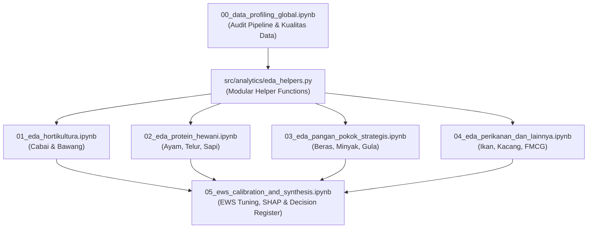

# Implementation Plan: Decision-Driven & Commodity-Grouped EDA
## Proyek: HargaWatch Surabaya

---

## 1. Konteks Proyek & Landasan Arsitektur

### 1.1 Ringkasan Sistem HargaWatch
**HargaWatch Surabaya** adalah platform intelijen harga pangan dan sistem peringatan dini (*Early Warning System* - EWS) yang beroperasi secara *end-to-end*:

```
Sumber Data                    Data Pipeline                  Machine Learning              Output
─────────────                  ─────────────                  ────────────────              ──────
SISKAPERBAPO Jatim ──┐    ┌── Scraper ──── Preprocessing     Champion Models ──┐    ┌── Supabase PostgreSQL
Open-Meteo Cuaca ────┼───►│   6 Pasar      ffill limit=7 ──► LightGBM/CatBoost├───►│── Telegram Bot Alert
BPS Inflasi ─────────┘    └── Produsen     Feature Eng.      Naive Baseline    │    └── Web Dashboard Next.js
                                                              EWS 4-Pilar ─────┘
```

### 1.2 Skala Dataset
- **Rentang Waktu**: Januari 2020 – Oktober 2026 (~2.435 hari harian kontinu).
- **Cakupan Pasar (6 Pasar Tradisional Surabaya)**:
  1. Pasar Tambahrejo (ID 1, Surabaya Utara, Ritel)
  2. Pasar Wonokromo (ID 2, Surabaya Selatan, Ritel)
  3. Pasar Genteng (ID 3, Surabaya Pusat, Ritel & Oleh-oleh)
  4. Pasar Pucang Anom (ID 4, Surabaya Timur, Ritel)
  5. **Pasar Keputran (ID 5, Surabaya Pusat, Pasar Induk Grosir)** ⭐ *Leading Indicator*
  6. Pasar Soponyono (ID 146, Surabaya Timur, Ritel)
- **Cakupan Komoditas**: 37 komoditas pangan pokok terbagi dalam 6 kelompok resmi (`docs/daftar_komoditas.md`).
- **Total Baris Fakta Harga**: ~476.000 rekaman transaksi (`fact_harga_pasar.csv`).

### 1.3 Pemodelan Machine Learning & EWS Saat Ini
- **Model Champion**:
  - *Cabai Rawit Merah (ID 50)*: `LightGBMForecaster` (WAPE ~13.79%) dengan routing fitur kalender.
  - *Bawang Merah (ID 39)* & *Telur Ayam (ID 16)*: `CatBoostForecaster` (WAPE ~6.60% dan ~2.79%).
  - *Beras Premium (ID 2)*, *Daging Ayam (ID 13)*, *Gula Pasir (ID 7)*: `NaiveLastValue` (WAPE < 1.0%).
- **Formulasi Early Warning System (EWS 4-Pilar: 20-20-20-40)**:
  - Pilar 1: Tren Historis 7 Hari (`pct_change_7d` $\ge 10\% \to 20\text{ pt}, \ge 5\% \to 10\text{ pt}$).
  - Pilar 2: Rasio Volatilitas Pasar ($\sigma_{7d} / \sigma_{14d} \ge 1.5 \to 20\text{ pt}, \ge 1.1 \to 10\text{ pt}$).
  - Pilar 3: Disparitas Grosir vs Ritel (Margin Keputran vs Rata-rata Ritel $< 5\% \to 20\text{ pt}, \le 10\% \to 10\text{ pt}$).
  - Pilar 4: Proyeksi Bahaya ML (Logika A: Median $H+7 \ge +15\% \to 20\text{ pt}$; Logika B: $p90 > \text{Max}_{90d} \to 20\text{ pt}$).
- **Target Standar Operasional Prosedur (SOP)**: Recall $\ge 90\%$, False Alarm Rate (FAR) $\le 20\%$, Lead Time $\ge 5 - 7$ hari.

---

## 2. Decision Map: 15 Keputusan Kritis yang Harus Dijawab EDA

EDA ini dirancang bersifat **decision-driven** (berorientasi pada aksi konkret dan kalibrasi parameter sistem produksi):

| ID | Domain | Pertanyaan Keputusan (Decision Question) | Jika Ya (Konsekuensi) | Jika Tidak (Konsekuensi) |
|:---:|:---|:---|:---|:---|
| **D1** | Data Quality | Apakah imputasi `ffill limit=7` cukup menutup gap tanpa menciptakan *zombie data*? | Pertahankan `limit=7` di preprocessing | Kurangi limit atau terapkan segmentasi per pasar |
| **D2** | Data Quality | Pasar mana yang datanya paling sering bolong? Apakah Pasar Soponyono (ID 146) reliabel? | Bobot 6 pasar setara | Beri penyesuaian bobot / flag warning di UI |
| **D3** | Data Quality | Apakah ada komoditas lain yang perlu di-drop karena kekosongan data > 90%? | Pertahankan 37 komoditas aktif | Masukkan komoditas baru ke `DROP_KOMODITAS` |
| **D4** | Temporal | Apakah terdapat efek *weekend* signifikan (harga Sabtu-Minggu lebih tinggi)? | Aktifkan `target_is_weekend` lintas komoditas | Matikan fitur weekend (mengurangi dimensionalitas) |
| **D5** | Temporal | Seberapa besar lonjakan harga pada masa Ramadan & pra-Ramadan (H-14)? | Perluas routing `is_ramadan` ke komoditas lain | Cukup pertahankan kalender khusus Cabai |
| **D6** | Temporal | Apakah ada pola musim panen/paceklik bulanan di luar Ramadan? | Tambahkan fitur `target_bulan` untuk kelompok terkait | Variasi bulanan cukup diwakili lag harga |
| **D7** | Temporal | Apakah libur nasional non-keagamaan memicu lonjakan harga signifikan? | Pertahankan `target_is_libur_nasional` | Drop fitur libur nasional (kurangi noise) |
| **D8** | Eksogenus | Apakah curah hujan lokal Surabaya berkorelasi dengan harga hortikultura? | Re-evaluasi fitur cuaca lokal | Konfirmasi keputusan ablasi: cuaca lokal tidak dipakai |
| **D9** | Eksogenus | Apakah harga produsen (RPH Pegirikan & PS Bendul Mrisi) memimpin harga konsumen? | Integrasikan lag produsen ke model forecasting | Gunakan data produsen khusus untuk Pilar 3 EWS |
| **D10** | Eksogenus | Apakah inflasi bulanan BPS berkorelasi sebagai prediktor harga harian pasar? | Gunakan data inflasi bulanan | Drop inflasi dari daily model (terlalu lagging) |
| **D11** | EWS Tuning | Apakah threshold rasio volatilitas $\ge 1.5$ (Pilar 2) menimbulkan banyak false alarm? | Naikkan threshold ke 1.8 atau 2.0 | Pertahankan threshold 1.5 |
| **D12** | EWS Tuning | Apakah margin Keputran $< 5\%$ konsisten memberikan lead time $\ge 5$ hari sebelum krisis ritel? | Validasi bobot 20 poin Pilar 3 | Sesuaikan threshold margin atau ubah formula |
| **D13** | EWS Tuning | Apakah threshold momentum 7 hari $\ge 10\%$ (Pilar 1) terlalu longgar / ketat secara empiris? | Kalibrasi threshold Pilar 1 | Pertahankan threshold 10% |
| **D14** | Disparitas | Apakah disparitas harga antar 6 pasar persisten dan berpola tetap? | Pertahankan `pasar_id` sebagai fitur kategorikal kuat | Gunakan agregasi harga rata-rata kota |
| **D15** | Disparitas | Berapa hari jeda waktu (*lead-lag*) transmisi kenaikan harga dari Pasar Keputran ke ritel? | Buat fitur baru `keputran_price_lag_Xd` | Cukup andalkan lag lokal masing-masing pasar |

---

## 3. Struktur Notebook: Pendekatan Hibrida Berbasis Kategori Komoditas

Struktur notebook mengombinasikan **Audit Pipeline Global** dengan **Pemisahan Per Kategori Komoditas** sesuai klasifikasi resmi `docs/daftar_komoditas.md`, diakhiri dengan **Sintesis EWS & Model ML**:

```
notebook/
├── 00_data_profiling_global.ipynb             # [Global] Audit Kualitas Data 37 Komoditas & 6 Pasar
│
├── 01_eda_hortikultura.ipynb                  # [Deep EDA - Tier 1] Kelompok Sayuran & Bumbu Dapur
├── 02_eda_protein_hewani.ipynb                # [Deep EDA - Tier 1] Kelompok Protein Hewani
├── 03_eda_pangan_pokok_strategis.ipynb        # [Focused EDA - Tier 2] Pangan Pokok, Minyak, & Gula
├── 04_eda_perikanan_dan_lainnya.ipynb         # [Light EDA - Tier 3] Perikanan, Kacang-kacangan, & FMCG
│
└── 05_ews_calibration_and_synthesis.ipynb       # [Global] Kalibrasi Threshold EWS & Diagnostik Model
```

---

### Rincian Modul Notebook

#### Notebook 00: `00_data_profiling_global.ipynb`
- **Fokus**: Kualitas data, kelengkapan, audit temporal, dan integritas pipeline harian.
- **Cakupan Data**: Seluruh 37 komoditas pada 6 pasar tradisional (Jan 2020 – Okt 2026).
- **Analisis Utama**:
  1. Dimensi data, rentang tanggal per pasar, dan identifikasi tanggal kosong.
  2. Peta panas (*heatmap*) proporsi `is_imputed` per pasar $\times$ komoditas $\times$ tahun.
  3. Evaluasi streak imputasi terpanjang untuk memvalidasi batas `limit=7` (*zombie data check*).
  4. Analisis komparasi reliabilitas data antar pasar (menilai Pasar Soponyono vs Keputran vs Tambahrejo).
  5. Deteksi harga anomali ($\le 0$ rupiah, $> 500.000$ rupiah, dan lonjakan $> 50\%$ dalam sehari).
- **Keputusan yang Dihasilkan**: **D1**, **D2**, **D3**.

---

#### Notebook 01: `01_eda_hortikultura.ipynb` ⭐ *Prioritas Tertinggi (Volatile Foods)*
- **Kelompok Komoditas** (`docs/daftar_komoditas.md` Section Sayuran & Bumbu Dapur):
  - Cabe Rawit Merah (Target Utama ID 50), Cabe Merah Besar, Cabe Merah Keriting.
  - Bawang Merah (Target ID 39), Bawang Putih Sinco/Honan.
  - Tomat Merah, Buncis, Kentang, Kol/Kubis, Wortel.
- **Karakteristik Domain**: Sangat mudah busuk (*perishable*), panen musiman, volatilitas tertinggi di pasar pangan.
- **Analisis Utama**:
  1. *Univariate & Volatilitas*: Ranking Coefficient of Variation (CV) dan uji stasioneritas (ADF/KPSS).
  2. *Dekomposisi Temporal*: Pola musiman bulanan (siklus panen Nganjuk, Kediri, Probolinggo), efek pra-Ramadan & Ramadan, efek libur nasional.
  3. *Cross-Market Dynamic (Keputran as Leading Indicator)*:
     - Cross-correlation function (CCF) antara Pasar Keputran vs pasar ritel (mencari lag transmisi optimal).
     - Analisis dinamika margin grosir-ritel saat terjadi lonjakan harga.
  4. *Evaluasi Faktor Eksogen*:
     - Korelasi harga cabai vs curah hujan lokal Surabaya (`fact_cuaca`) untuk membuktikan hipotesis bahwa cuaca lokal tidak berkorelasi (karena pasokan berasal dari luar Surabaya).
     - Korelasi harga cabai terhadap harga produsen (`fact_harga_produsen` titik pantau PS Bendul Mrisi).
- **Keputusan yang Dihasilkan**: **D4**, **D5**, **D6**, **D8**, **D9**, **D12**, **D14**, **D15**.

---

#### Notebook 02: `02_eda_protein_hewani.ipynb` ⭐ *Prioritas Tertinggi (Demand-Shock & Pakan)*
- **Kelompok Komoditas** (`docs/daftar_komoditas.md` Section Protein Hewani):
  - Daging Ayam Ras (Target ID 13), Daging Ayam Kampung.
  - Telur Ayam Ras (Target ID 16), Telur Ayam Kampung.
  - Daging Sapi Paha Belakang.
- **Karakteristik Domain**: Terikat siklus biologis ternak (DOC, masa afkir), biaya pakan (jagung/kedelai), dan lonjakan permintaan ekstrem menjelang perayaan keagamaan.
- **Analisis Utama**:
  1. *Event Study Hari Besar Keagamaan*: Analisis lonjakan harga pada H-14 pra-Ramadan, Idulfitri, Iduladha, dan Nataru (mengukur magnitude lonjakan rata-rata).
  2. *Korelasi Pakan & Integrasi Hulu-Hilir*:
     - Hubungan harga Daging Ayam dan Telur terhadap Jagung Pipilan Kering.
     - Korelasi harga Daging Sapi pasar konsumen terhadap data produsen RPH Pegirikan (`fact_harga_produsen`).
  3. *Analisis Disparitas Pasar*: Perbandingan spread harga ayam dan daging sapi antar 6 pasar.
  4. *Evaluasi Volatilitas & Regim Harga*: Mengapa Telur Ayam cocok dengan CatBoost sementara Daging Ayam stabil dengan Naive.
- **Keputusan yang Dihasilkan**: **D4**, **D5**, **D7**, **D9**, **D14**.

---

#### Notebook 03: `03_eda_pangan_pokok_strategis.ipynb` *(Focused EDA - Administered Goods)*
- **Kelompok Komoditas** (`docs/daftar_komoditas.md` Section Pangan Pokok & Strategis):
  - Beras Medium, Beras Premium (Target ID 2).
  - Gula Kristal Putih (Target ID 7).
  - Minyak Goreng Curah (Target ID 10), Minyak Goreng Kemasan Premium, Minyak Goreng MINYAKITA.
  - Terigu Protein Sedang, Jagung Pipilan Kering.
- **Karakteristik Domain**: Bahan pokok utama berbobot inflasi tinggi, diatur regulasi pemerintah (HET), dan sering diintervensi oleh Bulog (SPHP) & Operasi Pasar Murah.
- **Analisis Utama**:
  1. *Kepatuhan Terhadap Regulasi (HET Check)*: Analisis deviasi harga pasar aktual terhadap batas Harga Eceran Tertinggi (HET) pemerintah sepanjang 2020–2026.
  2. *Analisis Sticky Price & Justifikasi Model*: Pembuktian statistik mengapa model Naive Last Value menghasilkan WAPE sangat rendah (< 1%) pada Beras Premium dan Gula.
  3. *Substitusi Intra-Kelompok*: Korelasi harga antar varian komoditas (Beras Medium vs Premium; Minyakita vs Curah vs Kemasan Premium).
  4. *Hubungan dengan Inflasi Bulanan*: Evaluasi korelasi harga beras dan minyak goreng terhadap angka inflasi resmi BPS Kota Surabaya (`fact_inflasi`).
- **Keputusan yang Dihasilkan**: **D10**, **D14**.

---

#### Notebook 04: `04_eda_perikanan_dan_lainnya.ipynb` *(Light EDA - Profiling Cepat)*
- **Kelompok Komoditas**:
  - *Perikanan*: Ikan Bandeng, Ikan Kembung, Ikan Tongkol, Ikan Cakalang, Ikan Tuna, Ikan Asin Teri.
  - *Kacang-kacangan & Umbi*: Kedelai Impor, Kacang Hijau, Kacang Tanah, Ketela Pohon.
  - *Barang Pabrikan (FMCG)*: Susu Kental Manis Bendera, Susu Kental Manis Indomilk, Indomie Kari Ayam, Garam Beryodium Halus.
- **Karakteristik Domain**: Variasi cuaca maritim (ikan) dan harga stabil pabrikan yang terikat rantai logistik nasional.
- **Analisis Utama**:
  1. Profil statistik dasar (Mean, Median, Std, Min, Max).
  2. Verifikasi stabilitas harga produk pabrikan (FMCG) untuk memastikan bahwa kelompok ini tidak membutuhkan model GBDT yang kompleks.
  3. Korelasi musiman sederhana pada komoditas ikan laut (hubungan musiman angin/hujan terhadap ketersediaan ikan).
- **Keputusan yang Dihasilkan**: Konfirmasi cakupan model eksperimen tetap berfokus pada Tier 1 & Tier 2.

---

#### Notebook 05: `05_ews_calibration_and_synthesis.ipynb` ⭐ *Sintesis Strategis & Model ML*
- **Fokus**: Menghubungkan seluruh temuan empiris ke dalam penyempurnaan sistem Early Warning dan model peramalan produksi.
- **Analisis Utama**:
  1. *Kalibrasi Threshold EWS 4-Pilar*:
     - Distribusi empiris `pct_change_7d` (Pilar 1) $\to$ evaluasi threshold $5\%$ dan $10\%$.
     - Distribusi empiris rasio volatilitas $\sigma_{7d} / \sigma_{14d}$ (Pilar 2) $\to$ evaluasi threshold $1.1$ dan $1.5$.
     - Evaluasi empiris margin grosir Keputran $< 5\%$ (Pilar 3) terhadap krisis harga ritel.
  2. *Simulasi Grid Search & Kurva Pareto EWS*:
     - Simulasi variasi kombinasi threshold untuk mengoptimasi target SOP: **Recall $\ge 90\%$** dan **False Alarm Rate (FAR) $\le 20\%$**.
  3. *Event Study Validasi Krisis Historis*:
     - Evaluasi 5 episode lonjakan harga ekstrem terbesar (2020–2026) pada Cabai Rawit dan Bawang Merah. Mengukur apakah sistem memberikan peringatan status TINGGI dengan lead time 5–7 hari sebelum puncak harga.
  4. *Diagnostik Model & Validasi SHAP*:
     - Visualisasi SHAP Beeswarm & Dependence plot untuk Champion LightGBM (Cabai) dan CatBoost (Bawang).
     - Analisis residual $(y - \hat{y})$ untuk mendeteksi potensi *systematic underprediction* saat hari raya.
  5. *Penyusunan Decision Register Final*: Rangkuman keputusan D1–D15 beserta rekomendasi perubahan kode pipeline.
- **Keputusan yang Dihasilkan**: **D11**, **D12**, **D13**, validasi parameter produksi.

---

## 4. Arsitektur Kode Pembantu (DRY Principle): `src/analytics/eda_helpers.py`

Untuk mencegah duplikasi kode di 6 notebook, modul helper disiapkan di `src/analytics/eda_helpers.py`:

```
src/analytics/eda_helpers.py
├── load_cleaned_market_data()         # Load data gabungan pasar + komoditas + kalender
├── calculate_summary_stats()          # Menghasilkan tabel metrik: mean, std, CV, skewness, min, max
├── test_stationarity()                # Uji ADF dan KPSS terotomatisasi
├── plot_commodity_time_series()       # Standardized line plot tren harga harian + rolling mean
├── plot_market_spread_boxplot()       # Boxplot perbandingan sebaran harga 6 pasar
├── compute_lead_lag_cross_corr()      # Kalkulasi korelasi silang (CCF) lag -14 s.d. +14 hari
├── calculate_ramadan_impact()         # Perhitungan perbedaan harga pra-Ramadan vs Ramadan vs baseline
└── evaluate_ews_threshold_matrix()    # Grid evaluation untuk matriks Recall vs False Alarm Rate
```

---

## 5. Matriks Prioritas Komoditas Berdasarkan Kategori Resmi

| Kategori (`docs/daftar_komoditas.md`) | Komoditas Representatif Utama | Prioritas Analisis | Notebook Alokasi |
|:---|:---|:---:|:---:|
| **Sayuran & Bumbu Dapur** | Cabe Rawit Merah (50), Bawang Merah (39), Cabe Merah Keriting, Bawang Putih | **Tier 1 (Mendalam)** | `01_eda_hortikultura` |
| **Protein Hewani** | Daging Ayam Ras (13), Telur Ayam Ras (16), Daging Sapi Paha Belakang | **Tier 1 (Mendalam)** | `02_eda_protein_hewani` |
| **Pangan Pokok & Strategis** | Beras Premium (2), Beras Medium, Minyakita, Minyak Curah, Gula Pasir (7) | **Tier 2 (Fokus HET)** | `03_eda_pangan_pokok_strategis` |
| **Perikanan** | Ikan Bandeng, Ikan Kembung, Ikan Tongkol, Ikan Teri | **Tier 3 (Ringkas)** | `04_eda_perikanan_dan_lainnya` |
| **Kacang-kacangan & Umbi** | Kedelai Impor, Kacang Tanah, Ketela Pohon | **Tier 3 (Ringkas)** | `04_eda_perikanan_dan_lainnya` |
| **Barang Pabrikan (FMCG)** | Indomie Kari Ayam, Susu Kental Manis, Garam Beryodium | **Tier 3 (Verifikasi)** | `04_eda_perikanan_dan_lainnya` |

---

## 6. Rencana Urutan Eksekusi & Timeline



| Tahap | Aktivitas | Estimasi Pengerjaan | Output Utama |
|:---:|:---|:---:|:---|
| **Langkah 1** | Implementasi `src/analytics/eda_helpers.py` | 1 Jam | Modul helper fungsi visualisasi & metrik terstandar |
| **Langkah 2** | Eksekusi `00_data_profiling_global.ipynb` | 1–2 Jam | Data Quality Scorecard & keputusan D1, D2, D3 |
| **Langkah 3** | Eksekusi `01_eda_hortikultura.ipynb` | 2–3 Jam | Profil volatilitas cabai/bawang, lead-lag Keputran, validasi cuaca (D8, D12, D15) |
| **Langkah 4** | Eksekusi `02_eda_protein_hewani.ipynb` | 2 Jam | Efek Ramadan/hari besar, integrasi produsen RPH (D5, D9) |
| **Langkah 5** | Eksekusi `03_eda_pangan_pokok_strategis.ipynb` | 1.5 Jam | Evaluasi kepatuhan HET & justifikasi Naive model (D10) |
| **Langkah 6** | Eksekusi `04_eda_perikanan_dan_lainnya.ipynb` | 1 Jam | Profil deskriptif komoditas non-prioritas ML |
| **Langkah 7** | Eksekusi `05_ews_calibration_and_synthesis.ipynb` | 2–3 Jam | Kalibrasi threshold EWS (D11, D13), validasi SHAP, Decision Register final |

---

## 7. Deliverables & Rekomendasi Modifikasi Kode Produksi

Setelah seluruh notebook dieksekusi, deliverable yang akan dihasilkan mencakup:
1. **Decision Register D1–D15 Lengkap** (memuat temuan data riil, keputusan desain, dan tindak lanjut kode).
2. **Laporan Kalibrasi EWS**: Penyesuaian ambang batas pilar risiko berdasarkan trade-off Recall vs False Alarm Rate.
3. **Daftar Modifikasi Kode Produksi**:
   - `src/analytics/features.py`: Penambahan fitur `keputran_price_lag` atau perluasan fitur kalender jika terbukti signifikan.
   - `src/safety/early_warning.py`: Penyesuaian bobot/ambang batas pilar EWS berdasarkan hasil simulasi historis.
   - `src/pipeline/preprocessing_final.py`: Penyesuaian limit imputasi atau filter komoditas jika ditemukan anomali data.
