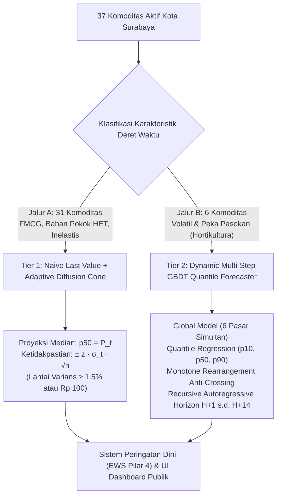
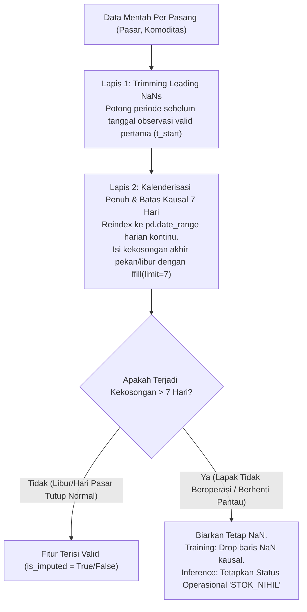
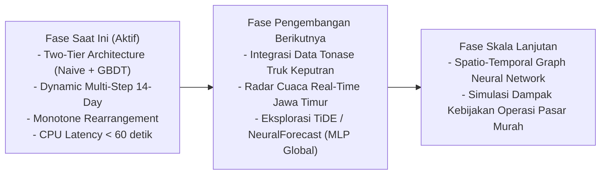

# Metodologi Forecasting Harga Pangan Kota Surabaya
## Arsitektur Dua Jalur (Two-Tier), Integritas Deret Waktu, dan Sistem Inferensi Multi-Horizon

> **Status Dokumen:** Produksi / Aktif  
> **Ruang Lingkup:** 37 Komoditas Pangan Strategis di 6 Pasar Tradisional Kota Surabaya  
> **Pembaruan Terakhir:** Oktober 2026 (Sinkronisasi Pipeline Produksi dan Arsitektur Multi-Horizon)

---

## 1. Ringkasan Eksekutif & Filosofi Desain

Sistem peramalan harga pangan Kota Surabaya dirancang untuk memberikan proyeksi harga harian hingga **14 hari ke depan ($H+1$ s.d. $H+14$)** bagi 37 komoditas pangan aktif yang dipantau di 6 pasar tradisional (Wonokromo, Genteng, Tambahrejo, Pucang Anom, Pabean, dan Keputran). 

Tantangan utama pemodelan harga pangan eceran di tingkat kota meliputi:
1. **Heterogenitas Dinamika Harga:** Komoditas hortikultura (cabai, bawang) memiliki volatilitas sangat tinggi akibat cuaca dan rantai pasok pendek, sedangkan produk industri (mie instan, susu bubuk) dan komoditas dengan Harga Eceran Tertinggi (HET) memiliki harga flat atau bergerak bertangga (*step-wise*).
2. **Keterbatasan Komputasi:** Seluruh proses pelatihan (*training*) dan inferensi harian wajib beroperasi pada arsitektur **CPU-Only** tanpa ketergantungan GPU, dengan waktu eksekusi harian < 60 detik.
3. **Ketiadaan Data Pasokan Hulu Real-Time:** Tidak tersedianya data tonase harian truk bongkar muat pasar induk menuntut sistem untuk memaksimalkan sinyal deret waktu historis tanpa melakukan *over-engineering*.

Untuk menjawab tantangan tersebut, sistem menerapkan **Kerangka Kerja Peramalan Dua Jalur (Two-Tier Forecasting Framework)** berlandaskan *Prinsip Parsimoni (Occam's Razor)*:

### 1.1 Prinsip Parsimoni & Batas Kejenuhan Data (*Data Ceiling*)
Dalam literatur peramalan deret waktu (Makridakis et al., 2022; Elsayed et al., 2021), model kompleks berbasis *Machine Learning* hanya memberikan keunggulan empiris jika deret waktu memiliki struktur sinyal non-linear yang cukup kuat melebihi tingkat derau (*noise*). 
- Pada **31 komoditas Jalur A**, model GBDT yang dilatih mengalami fenomena *variance amplification* atau *flat overfit*, di mana model mencoba memprediksi fluktuasi mikro pada data yang secara ekonomi bersifat konstan atau dikendalikan regulasi pemerintah. Model *Naive Last Value* secara empiris terbukti memiliki *Weighted Absolute Percentage Error* (WAPE) terendah dan stabilitas tertinggi.
- Pada **6 komoditas Jalur B** (Cabai Rawit, Cabai Merah Besar, Cabai Keriting, Bawang Merah, Bawang Putih, dan Tomat), dinamika pasokan, efek hari libur, dan siklus mingguan menghasilkan sinyal non-linear yang kuat, sehingga GBDT menghasilkan perbaikan akurasi terarah (*Directional Accuracy*) yang signifikan dibanding baseline.

---

## 2. Integritas Data & Penanganan Nilai Hilang (*Missing Values*)

### 2.1 Domain Riwayat Data Pasar Surabaya
Dataset mentah bersumber dari sistem pemantauan harga harian (SP2KP/Siskaperbapo) yang mencakup 6 pasar di Kota Surabaya:
* **Pasar Induk Sayur:** Keputran (pusat distribusi grosir hortikultura).
* **Pasar Eceran Utama:** Wonokromo, Genteng, Tambahrejo, Pucang Anom, Pabean.

Secara historis, terdapat variasi tanggal mulai pencatatan (*onboarding*) antar-pasar:
- Pasar Genteng, Wonokromo, Tambahrejo, Pabean, dan Keputran memiliki riwayat transaksi sejak Januari 2020.
- Pasar Pucang Anom baru diintegrasikan ke dalam sistem pemantauan resmi pada awal tahun 2024.

Kondisi ini menyebabkan munculnya **17.699 nilai `NaN`** pada matriks panel gabungan awal.

### 2.2 Penanganan Kausal Tiga Lapis (Zero Zombie Data & Zero Lookahead Bias)
Sistem menolak keras praktik interpolasi linier atau imputasi dua arah (*backward/forward fill* tanpa batas) karena:
1. **Bias Masa Depan (*Lookahead Bias*):** Menggunakan data masa depan untuk mengisi masa lalu melanggar hukum kausalitas deret waktu.
2. **Data Zombi (*Zombie Data*):** Menerapkan *forward-fill* tanpa batas akan memperbanyak harga fiktif (misalnya menduplikasi harga ikan dari tahun 2021 hingga 2024 pada pasar yang sebenarnya belum mencatat komoditas tersebut).

Solusi arsitektural yang diimplementasikan terdiri dari 3 lapis:

1. **Lapis 1 (Trimming Leading NaNs):** Seri data dipotong secara kausal pada tanggal transaksi valid pertama ($t_{\text{first}}$) untuk masing-masing kombinasi pasar-komoditas.
2. **Lapis 2 (Continuous Calendar Reindexing & Causal Bound):** Kalender direindeks menjadi deret harian tanpa jeda (`pd.date_range`). Hari libur pasar atau jeda pencatatan singkat diisi menggunakan `ffill(limit=7)`. Batas 7 hari dipilih berdasarkan batas kedaluwarsa kesegaran stok eceran tradisional.
3. **Lapis 3 (Operational Status `STOK_NIHIL`):** Jika suatu pasar tidak memiliki transaksi valid selama lebih dari 7 hari berturut-turut pada tanggal inferensi, sistem tidak memaksakan inferensi harga, melainkan menandai entitas tersebut berstatus `STOK_NIHIL / DATA_TIDAK_TERSEDIA` untuk melindungi sistem dari proyeksi palsu (*phantom projection*).

---

## 3. Rekayasa Fitur Tabular (*Feature Engineering*)

Untuk 6 komoditas volatil (Jalur B), model GBDT memproses matriks fitur tabular harian yang dirancang tanpa kebocoran data (*zero data leakage*):

| Kategori Fitur | Nama Fitur | Deskripsi Matematis / Logika | Peran Domain |
|---|---|---|---|
| **Autoregresif (Lags)** | `price_lag_1`, `price_lag_2`, `price_lag_3`, `price_lag_7` | $y_{t-1}, y_{t-2}, y_{t-3}, y_{t-7}$ | Menangkap inersia harga jangka pendek dan autokorelasi mingguan pasar tradisional. |
| **Statistik Bergerak** | `rolling_mean_7d`, `rolling_std_7d` | $\mu_{t, 7} = \frac{1}{7}\sum_{i=1}^7 y_{t-i}$, $\sigma_{t, 7}$ | Menangkap level harga rata-rata mingguan dan intensitas volatilitas terkini. |
| **Dinamika Kalender Target** | `dayofweek`, `is_weekend` | Variabel kalender pada tanggal target $t+h$ | Menangkap pola lonjakan belanja rumah tangga di akhir pekan (*weekend demand shock*). |
| **Siklus Religius & Nasional** | `target_is_libur_nasional`, `target_is_ramadan`, `target_is_pra_ramadan` | Indikator biner kalender Hijriah / SKB 3 Menteri | Menangkap *demand shock* pra-Ramadan (H-14 s.d. H-1) dan hari raya Idulfitri. |
| **Sinyal Cuaca Tertunda (BMKG)** | `rain_sum_14d`, `rain_lag_28d` | Akumulasi curah hujan masa lalu di sentra produksi Jawa Timur | Mengakomodasi jeda waktu kerusakan tanaman akibat cuaca ekstrem hingga gagal panen di pasar kota. |
| **Identitas Spasial** | `pasar_id` | Variabel kategorikal (6 pasar) | Memungkinkan satu *Global Model* menangkap hierarki harga antar-pasar secara simultan. |

---

## 4. Metodologi Pemodelan & Inferensi Produksi

### 4.1 Jalur A: Naive Last Value dengan Kerucut Ketidakpastian Adaptif
Untuk 31 komoditas stabil, proyeksi titik tengah (*median forecast*) dirumuskan sebagai:
$$\hat{y}_{t+h|t} = y_t, \quad \forall h \in \{1, 2, \dots, 14\}$$

Rentang ketidakpastian dibangun menggunakan model difusi volatilitas (*Brownian Motion Uncertainty Cone*):
$$p_{10}(t+h) = \max\left(0, y_t - z_{0.10} \cdot \sigma_t \cdot \sqrt{h}\right)$$
$$p_{90}(t+h) = y_t + z_{0.90} \cdot \sigma_t \cdot \sqrt{h}$$
di mana $z_{0.90} = 1.2816$ dan $\sigma_t = \max\left(\text{std}_{30d}(y), 0.015 \cdot y_t, \text{Rp } 100\right)$. Penerapan batas bawah varians minimum (*adaptive variance floor*) memastikan kerucut ketidakpastian tidak runtuh menjadi nol (*zero-width interval*) pada produk yang mengalami stagnasi pencatatan historis.

### 4.2 Jalur B: Champion GBDT Direct H+7
Untuk komoditas volatil yang memiliki champion GBDT di registry, model dilatih untuk target langsung H+7 menggunakan algoritma *Gradient Boosted Decision Trees* (LightGBM / XGBoost / CatBoost) dengan *Pinball Loss (Quantile Objective)* pada tingkat kuantil $\alpha \in \{0.10, 0.50, 0.90\}$. Metrik champion pada registry adalah metrik benchmark untuk horizon tersebut, bukan bukti akurasi horizon lain:
$$\mathcal{L}_\alpha(y, \hat{y}) = \max\left(\alpha (y - \hat{y}), (1 - \alpha)(\hat{y} - y)\right)$$

#### Penjaminan Monotonitas Kuantil via *Monotone Rearrangement*
Pelatihan model kuantil secara terpisah pada $\alpha=0.10, 0.50, 0.90$ dapat memicu anomali *Quantile Crossing* ($p_{10} > p_{90}$) akibat keterbatasan sampel pada ekor distribusi. Sistem menerapkan penataan ulang monoton (*Monotone Rearrangement*, Chernozhukov, Fernández-Val, & Galichon, 2010):
$$p_{10}^*(t) = \min\left(p_{10}(t), p_{50}(t), p_{90}(t)\right)$$
$$p_{50}^*(t) = \text{median}\left(p_{10}(t), p_{50}(t), p_{90}(t)\right)$$
$$p_{90}^*(t) = \max\left(p_{10}(t), p_{50}(t), p_{90}(t)\right)$$
Prosedur ini terbukti secara matematis mempertahankan konsistensi estimasi tanpa menambah bias kesalahan.

### 4.3 Strategi Publikasi Multi-Horizon 14-Hari
Registry produksi saat ini menyediakan champion GBDT dengan target langsung H+7, bukan model khusus untuk setiap horizon. Karena itu, runner tidak menggunakan champion H+7 untuk memprediksi H+1 sampai H+14:

1. Untuk champion GBDT yang berhasil dimuat dan diinferensikan, model hanya digunakan pada H+7 dengan fitur pada tanggal origin dan fitur Keputran yang dibangun dari Pasar Induk Keputran (ID 5).
2. Horizon selain H+7 menggunakan baseline persistence yang tercatat eksplisit sebagai baseline/fallback. H+1 sampai H+6 berjangkar pada harga observasi terakhir; H+8 sampai H+14 berjangkar pada prediksi H+7 jika tersedia.
3. Jika inferensi champion H+7 gagal, H+7 juga menggunakan persistence dan dicatat sebagai fallback.
4. Champion Naive/SMA menjalankan strategi baseline yang terdaftar pada seluruh horizon. SMA-7 menggunakan rata-rata tujuh harga observasi terakhir, bukan harga terakhir.
5. Setiap baris forecast menyimpan `horizon`, `origin_date`, `model_name`, `model_horizon`, `model_sha256`, `is_fallback`, dan `forecast_run_id` untuk membedakan model champion dari baseline/fallback.

**Batas validasi:** WAPE champion H+7 hanya menjelaskan evaluasi H+7. Hasil H+1 dan H+8–H+14 tidak boleh disebut memiliki akurasi yang sama sebelum tersedia evaluasi walk-forward terpisah untuk horizon tersebut. Pengembangan berikutnya adalah evaluasi multi-horizon dan/atau champion terpisah per horizon, bukan menerapkan ulang model H+7 tanpa validasi.

---

## 5. Protokol Evaluasi & Formulasi Metrik Valid

### 5.1 Protokol Validasi Berjalan (*Walk-Forward Backtesting*)
Validasi performa model dilarang menggunakan *random k-fold split*. Sistem menerapkan *Rolling-Origin Walk-Forward Backtesting*:
- Titik pemotongan (*cutoff date*) digeser maju secara berkala sepanjang jendela pengujian 2024–2026.
- Model hanya melihat informasi sebelum titik origin $t$, lalu memproyeksikan horizon $t+1$ s.d. $t+14$.

### 5.2 Formulasi Metrik Evaluasi
Evaluasi kinerja model menggunakan metrik terstandarisasi:

1. **Weighted Absolute Percentage Error (WAPE):**
   $$\text{WAPE} = \frac{\sum_{i=1}^N |y_i - \hat{y}_i|}{\sum_{i=1}^N y_i} \times 100\%$$
   *Keunggulan:* Tidak terdistorsi oleh pembagian dengan nilai mendekati nol, sangat stabil untuk evaluasi agregat pangan.
2. **Mean Absolute Error (MAE):**
   $$\text{MAE} = \frac{1}{N}\sum_{i=1}^N |y_i - \hat{y}_i| \quad (\text{dalam satuan Rupiah/kg})$$
   *Keunggulan:* Transparan dan langsung dipahami oleh pemangku kepentingan kebijakan TPID.
3. **Prediction Interval Coverage Probability (PICP):**
   $$\text{PICP} = \frac{1}{N} \sum_{i=1}^N \mathbb{I}\left(p_{10, i} \le y_i \le p_{90, i}\right) \times 100\%$$
   Target nominal: $80\%$ (sesuai rentang kuantil $p_{10}$ s.d. $p_{90}$).
4. **Directional Accuracy (DA) & Active Directional Accuracy ($DA_{\text{active}}$):**
   Formulasi Directional Accuracy biner klasik mengalami distorsi berat pada komoditas stabil, di mana pergerakan nol ($\Delta y = 0$) sering dihitung sebagai prediksi salah arah atau menghasilkan akurasi artifisial. Sistem memisahkan evaluasi menjadi dua indikator:
   - **$DA_{\text{overall}}$:** Mengukur seluruh sampel pengujian dengan toleransi ambang pergerakan adaptif $\tau_t = \max(0.005 \cdot |y_{\text{origin}}|, 50)$.
   - **$DA_{\text{active}}$:** Mengukur ketepatan arah model **hanya pada hari-hari terjadinya pergerakan harga riil** ($|\Delta y_{\text{actual}}| > \tau_t$):
     $$DA_{\text{active}} = \frac{1}{|S_{\text{active}}|} \sum_{i \in S_{\text{active}}} \mathbb{I}\left(\text{sign}(\hat{y}_i - y_{\text{origin}, i}) == \text{sign}(y_i - y_{\text{origin}, i})\right)$$
     Indikator ini memastikan model Jalur B dinilai secara adil atas kemampuannya mengantisipasi lonjakan (*shock*) dan penurunan harga.

---

## 6. Integrasi dengan Early Warning System (EWS)

Hasil proyeksi peramalan disalurkan secara langsung ke mesin inferensi EWS (`src/safety/early_warning.py`):
- **Jalur B (6 Komoditas Volatil):** Proyeksi median $p_{50}$ pada horizon $H+7$ digunakan untuk menghitung laju kenaikan masa depan (*Projected Growth*), sedangkan kuantil atas $p_{90}$ dievaluasi terhadap rekor harga tertinggi 90 hari (*historical 90-day peak*) untuk mendeteksi risiko ekor (*tail-risk alarm*).
- **Jalur A (31 Komoditas Stabil):** Proyeksi median konstan dengan batas atas kuantil difusi $p_{90}(H+7)$ bertindak sebagai radar penangkap anomali harga pangan pokok.
- **Entitas Tidak Aktif:** Lapak atau pasar yang tidak mencatat transaksi $>7$ hari secara otomatis dikecualikan dari komputasi EWS untuk menghindari alarm palsu (*false positive suppression*).

---

## 7. Peta Jalan Riset & Pengembangan Masa Depan (Roadmap)

Sistem peramalan HargaWatch dirancang untuk terus berkembang seiring peningkatan ketersediaan data:

1. **Integrasi Data Pasokan Hulu (Pasar Induk Keputran):**
   Menghubungkan data volume tonase harian truk bongkar muat di Pasar Induk Keputran untuk memprediksi transmisi harga grosir-ke-eceran dengan jeda waktu 1–2 hari.
2. **Deep Learning untuk Deret Waktu Global (TiDE / N-HiTS):**
   Ketika variabel eksogen hulu telah tersedia, arsitektur *Time-series Dense Encoder (TiDE)* berbasis MLP murni (Das et al., 2023) layak diuji sebagai model global terpadu yang tetap efisien pada lingkungan CPU.
3. **Simulasi Dampak Intervensi Kebijakan:**
   Pengembangan modul counterfactual untuk memproyeksikan efektivitas intervensi Operasi Pasar Murah (OPM) oleh TPID Surabaya terhadap peredaman lonjakan harga pangan.

---

## 8. Referensi Akademis Terverifikasi

1. **Breiman, L.** (2001). *Random Forests*. Machine Learning, 45(1), 5–32.
2. **Chen, T., & Guestrin, C.** (2016). *XGBoost: A Scalable Tree Boosting System*. Proceedings of the 22nd ACM SIGKDD International Conference on Knowledge Discovery and Data Mining, 785–794.
3. **Chernozhukov, V., Fernández-Val, I., & Galichon, A.** (2010). *Quantile and Probability Curves Without Sorting*. Econometrica, 78(3), 1093–1125.
4. **Das, A., Kong, W., Leach, A., Mathur, S., Sen, R., & Yu, R.** (2023). *Long-term Forecasting with TiDE: Time-series Dense Encoder*. Transactions on Machine Learning Research (TMLR).
5. **Elsayed, S., Thyssens, D., Rashed, A., Jomaa, H. S., & Schmidt-Thieme, L.** (2021). *Do We Really Need Deep Learning Models for Time Series Forecasting?* arXiv preprint arXiv:2101.02118.
6. **Ke, G., Meng, Q., Finley, T., Wang, T., Chen, W., Ma, W., Ye, Q., & Liu, T.-Y.** (2017). *LightGBM: A Highly Efficient Gradient Boosting Decision Tree*. Advances in Neural Information Processing Systems (NeurIPS), 30, 3146–3154.
7. **Koenker, R., & Bassett Jr, G.** (1978). *Regression Quantiles*. Econometrica: Journal of the Econometric Society, 33–50.
8. **Makridakis, S., Spiliotis, E., & Assimakopoulos, V.** (2022). *The M5 competition: Results, findings, and conclusions*. International Journal of Forecasting, 38(4), 1346–1364.
9. **Montero-Manso, P., & Hyndman, R. J.** (2021). *Principles and algorithms for forecasting groups of time series: Locality and globality*. International Journal of Forecasting, 37(4), 1632–1653.
10. **Prokhorenkova, L., Gusev, G., Vorobev, A., Dorogush, A. V., & Gulin, A.** (2018). *CatBoost: unbiased boosting with categorical features*. Advances in Neural Information Processing Systems (NeurIPS), 31, 6638–6648.