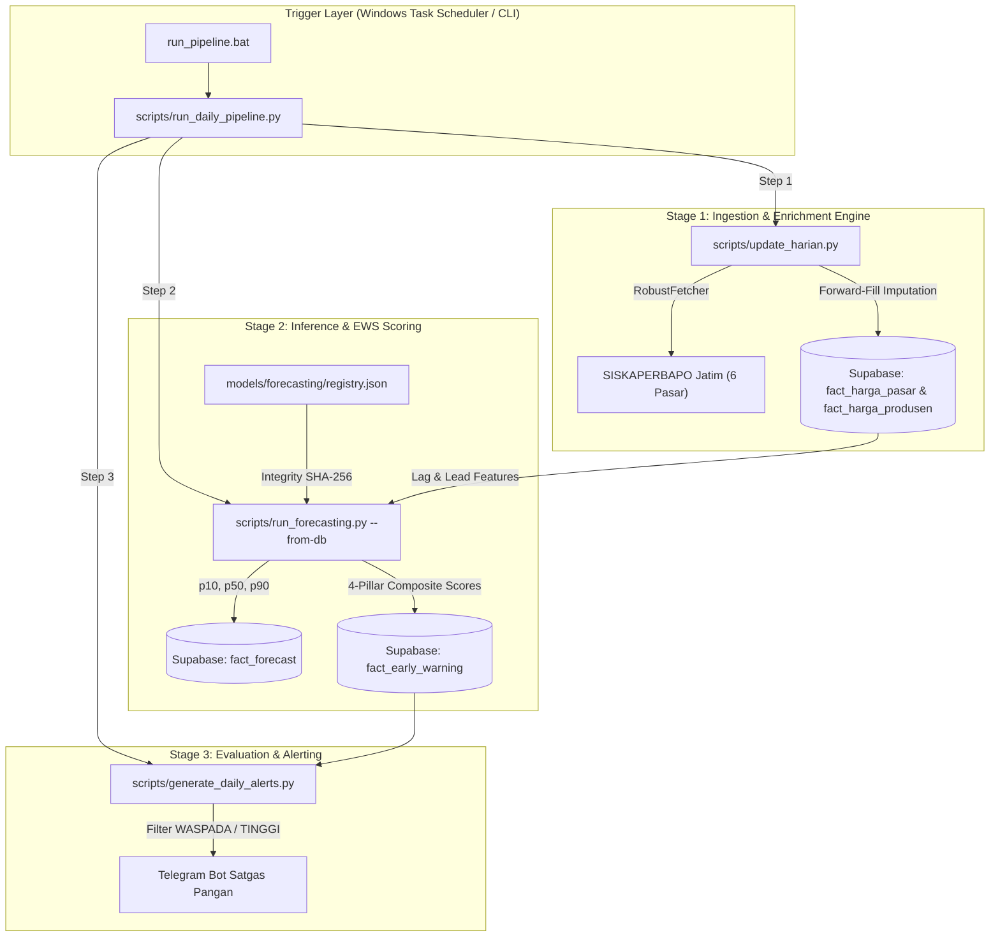

# Scripts & Production Orchestration Engine (`scripts/`)

Dokumentasi kontrak arsitektural, antarmuka CLI (*Command Line Interface*), batasan invariant (*system invariants*), serta protokol verifikasi untuk direktori `scripts/` pada sistem **HargaWatch Surabaya** berbasis **Elephant-Goldfish Model (EGM)**.

---

## Overview

Direktori `scripts/` merupakan lapisan orkestrator eksekutif (*Execution & Operational Layer*) yang bertanggung jawab menggerakkan seluruh siklus hidup data produksi HargaWatch Surabaya:
1. **Ingesti & Scraping Harian (On-Premise):** Menembus WAF Cloudflare SISKAPERBAPO Jawa Timur, menarik data harga 6 pasar strategis dan produsen, memvalidasi kualitas data, serta melakukan upsert ke Supabase PostgreSQL.
2. **Auto-Recovery & Catch-Up Ingestion:** Mendeteksi lubang data historis (*missing dates*) hingga 400 hari ke belakang dan melakukan backfill bertahap tanpa intervensi manual.
3. **Multi-Step Trajectory Forecasting ($H=1..14$):** Memuat artefak model champion terverifikasi, mengeksekusi rekayasa fitur dinamis (*zero lookahead bias*), dan menghasilkan interval ketidakpastian ($p_{10}, p_{50}, p_{90}$) untuk 37 komoditas pangan aktif.
4. **Adaptive Early Warning System (EWS):** Menghitung matriks risiko gabungan 4 pilar (Tren, Volatilitas dengan *plateau amnesia prevention*, Disparitas Spasial Grosir Keputran, dan Sinyal Bahaya Model ML).
5. **Stakeholder Alert Dispatching:** Mengevaluasi komoditas berstatus `WASPADA` dan `TINGGI`, memformat ringkasan krisis, dan mengirimkan notifikasi instan ke Bot Telegram Satgas Pangan.
6. **Parallel Multi-Core Experimentation & Retraining:** Melatih ulang arsitektur champion (LightGBM, CatBoost, XGBoost, Naive Last Value, SMA) melalui *rolling-origin walk-forward backtesting* secara paralel.

### System Boundaries
* **Hulu (*Upstream*):** Web portal SISKAPERBAPO Jatim, Open-Meteo ERA5 Reanalysis API, BPS Jawa Timur, dan model champion registry (`models/forecasting/registry.json`).
* **Hilir (*Downstream*):** Supabase PostgreSQL (`fact_harga_pasar`, `fact_harga_produsen`, `fact_cuaca`, `fact_forecast`, `fact_early_warning`), cache lokal (`data/processed/*.csv`), dan Bot Telegram Satgas Pangan.



---

## Interface

### Master & Operational CLI Scripts

- `run_daily_pipeline.py`: Master Pipeline Runner harian mengorkestrasi penarikan data, peramalan multi-step, kalkulasi risiko EWS, hingga penyiaran alert Telegram.
  - `--tanggal <YYYY-MM-DD>` *(opsional)*: Menentukan tanggal target scraping manual (default: kemarin WIB).
  - `--skip-scrape` *(flag)*: Melewati tahap scraping data pasar/produsen.
  - `--skip-forecast` *(flag)*: Melewati tahap peramalan dan penilaian risiko EWS.
  - `--local-only` *(flag)*: Menyimpan hasil prediksi dan EWS hanya ke file CSV lokal tanpa upsert ke Supabase.
  - `--horizon <int>` *(default: 14)*: Panjang horizon peramalan dalam hari.
  - *Exit Codes*: `0` (sukses), `1` (kegagalan fatal scraping), `2` (kegagalan inferensi/EWS).

- `update_harian.py`: Ingesti single-date ke Supabase dengan validasi anomali dan forward-fill imputation.
  - `--tanggal <YYYY-MM-DD>` *(opsional)*: Tanggal target (default: kemarin WIB).
  - *Exit Codes*: `0` (sukses atau hari libur resmi pasar tutup), `1` (kegagalan scraping/koneksi).

- `update_catchup.py`: Deteksi gap historis (hingga 400 hari ke belakang) dan backfill multivariat (pasar, produsen, cuaca).
  - `--maks <int>` *(default: 40)*: Batas maksimum tanggal bolong yang diproses dalam 1 sesi.
  - `--mulai <YYYY-MM-DD>` *(opsional)*: Titik awal pemaksaan pencarian tanggal bolong.
  - `--jendela <int>` *(default: 30)*: Jendela hari minimum yang selalu diverifikasi.

- `run_forecasting.py`: Mesin inferensi produksi untuk peramalan harga pangan 14 hari ke depan dan kalkulasi 4 pilar risiko EWS.
  - `--horizon <int>` *(default: 14)*: Horizon ramalan ($H=1..14$).
  - `--from-db` *(flag)*: Menarik data input langsung dari Supabase PostgreSQL (dengan fallback otomatis ke CSV lokal).
  - `--local-only` *(flag)*: Tidak melakukan upsert ke Supabase, hanya menyimpan output ke `data/processed/fact_forecast.csv` dan `data/processed/fact_early_warning.csv`.
  - `--komoditas-id <int>` *(opsional)*: Menjalankan inferensi hanya untuk satu komoditas spesifik.

- `generate_daily_alerts.py`: Evaluasi skor risiko gabungan dari tabel EWS untuk tanggal mutakhir dan menyiarkan notifikasi ke grup Satgas Pangan Telegram.
  - `--date <YYYY-MM-DD>` *(opsional)*: Tanggal record EWS yang dievaluasi (default: tanggal terbaru yang tersedia).

- `run_parallel_commodity_experiments.py`: Harness retraining paralel multi-core untuk seluruh 37 komoditas pangan aktif.
  - `--workers <int>` *(default: 4)*: Jumlah proses pekerja konkuren (`ProcessPoolExecutor`).
  - `--horizon <int>` *(default: 7)*: Horizon evaluasi benchmark.
  - `--force-all` *(flag)*: Memaksa pelatihan ulang seluruh komoditas tanpa membaca checkpoint cache.
  - `--commodities <id1,id2>` *(opsional)*: Membatasi daftar ID komoditas yang dieksekusi.

### Windows Automation Scripts
- `setup_task_scheduler.ps1`: Skrip registrasi otomatis Windows Task Scheduler untuk tugas harian.
- `run_background.vbs`: VBScript silent headless runner untuk background catch-up execution.
- `update_catchup_task.cmd`: Wrapper batch catch-up dengan rotasi log otomatis 14 hari.

---

## Invariants

- **On-Premise Scraping Mandatory (Cloudflare WAF Block):** Server SISKAPERBAPO memblokir IP datacenter publik (HTTP 403 Forbidden). Scraping harian wajib dijalankan On-Premise via Windows Task Scheduler. DILARANG memindahkan skrip scraping ke GitHub Actions.
- **Zero Lookahead Bias:** Dilarang menggunakan backward-fill (`bfill`), centered rolling windows, atau interpolasi linier pada data harga. Imputasi `ffill` dibatasi ketat maksimum 7 hari (`ffill(limit=7)`). Seluruh fitur rolling window wajib di-shift mundur (`.shift(1)`).
- **Wholesale Transmission Features:** Komoditas volatil wajib mengikutsertakan fitur lag transmisi harga Pasar Induk Keputran (`keputran_price_lag_1`, `lag_2`, `lag_3`).
- **EWS Plateau Amnesia Prevention:** Pada kondisi krisis berkepanjangan dengan harga tertahan tinggi, rasio standar deviasi $std_{7d}/std_{30d}$ bisa mengecil; sistem menerapkan Z-score override ($Z \ge 2.0$) agar pilar volatilitas tetap mempertahankan 20 poin risiko penuh.
- **Model Deserialization Integrity:** Pemuatan model `.pkl` wajib memverifikasi path traversal containment (`resolved_path.startswith(base_resolved)`) dan validasi SHA-256 digest terhadap `registry.json`.
- **Database Connection Pooler Fallback:** Ingestion dan inferensi memprioritaskan port 6543 (*Transaction Pooler*) dan beralih otomatis ke port 5432 (*Session Pooler*) bila terjadi timeout.

---

## Side Effects

- **Remote Database Mutations:** Melakukan insert/upsert idempotent ke tabel Supabase PostgreSQL (`fact_harga_pasar`, `fact_harga_produsen`, `fact_cuaca`, `fact_forecast`, `fact_early_warning`).
- **External Network Scraping:** Menembus web SISKAPERBAPO Jatim, Open-Meteo ERA5 API, dan BPS Jatim.
- **Telegram Notification Broadcast:** Mengirim pesan krisis pangan ke Satgas Pangan via Telegram Bot API. Token bot dimasker otomatis (`[REDACTED_BOT_TOKEN]`).
- **Local Filesystem Disk Writes:** Menulis log rotasi di `logs/` dan output cache di `data/processed/`.

---

## Verification

```bash
# 1. Jalankan unit dan integrasi test lengkap (79 tests)
pytest tests/ -v

# 2. Jalankan test terarah modul peramalan dan EWS
pytest tests/test_forecast_engine.py -v
pytest tests/test_ews_adaptive.py -v
pytest tests/test_anomaly_detector.py -v

# 3. Smoke test inferensi peramalan lokal (dry-run tanpa database mutation)
python scripts/run_forecasting.py --horizon 14 --local-only

# 4. Smoke test pipeline eksekusi harian
python scripts/run_daily_pipeline.py
```
