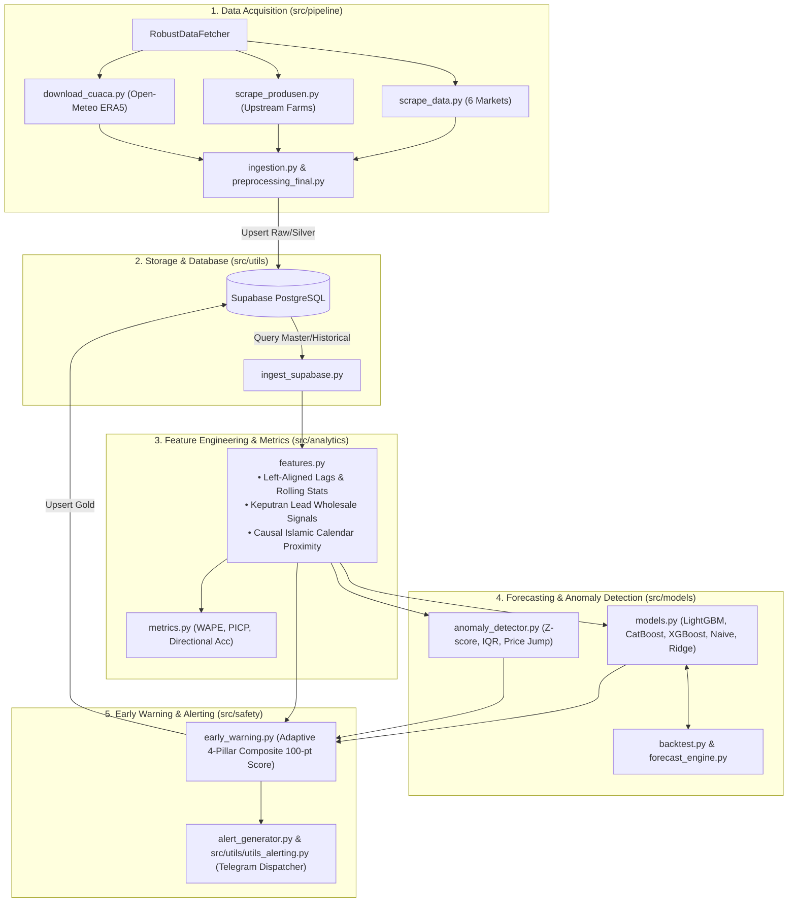

# Core System Intelligence (`src/`)

`src/` encapsulates the complete backend intelligence core of **HargaWatch Surabaya**, encompassing data acquisition from traditional markets, causal feature engineering, multi-quantile machine learning forecasting, statistical anomaly detection, an adaptive 4-pillar Early Warning System (EWS), and automated emergency alerting.

---

## Overview

Lapisan komputasi dan pemodelan analitik cerdas yang menggerakkan platform HargaWatch Surabaya. Sistem beroperasi secara modular menghubungkan seluruh tahapan dari ingesti data mentah pasar fisik, standardisasi dataset tabular tanpa bias masa depan (*zero lookahead bias*), inferensi model kuantil multi-step ($H=1..14$), kalkulasi 4 pilar bahaya pangan, hingga pengiriman notifikasi darurat ke Satgas Pangan.



---

## Subdirectories & System Boundaries

- **`pipeline/`**: [`./pipeline/README.md`](./pipeline/README.md) — Network scraping SISKAPERBAPO 6 pasar Surabaya, HTTP retry fetcher, forward-fill imputation harian, unduh cuaca Open-Meteo, dan batch SQL upsert ke Supabase.
- **`models/`**: [`./models/README.md`](./models/README.md) — Arsitektur regresi kuantil multi-step ($p_{10}, p_{50}, p_{90}$), baseline Naive Last Value / SMA, walk-forward rolling-origin backtesting, dan detektor anomali statistik harga.
- **`safety/`**: [`./safety/README.md`](./safety/README.md) — Sistem Peringatan Dini (EWS) 4 pilar adaptif (Tren, Volatilitas dengan *anti-amnesia plateau*, Disparitas Spasial Grosir Keputran, Bahaya Model ML) dan generator pesan darurat Telegram.
- **`utils/`**: [`./utils/README.md`](./utils/README.md) — Manajemen koneksi pool Supabase PostgreSQL, migrasi skema tabel DDL, validasi kualitas data, dan pengiriman notifikasi dengan token tersanitasi.
- **`analytics/`**: [`./analytics/README.md`](./analytics/README.md) — Rekayasa fitur kausal, sinyal transmisi harga Pasar Induk Keputran, kalender Islam (jarak ke Idulfitri), dan metrik evaluasi peramalan waktu (WAPE, MAE, PICP).

---

## Global Invariants

1. **Strict Zero Lookahead Temporal Causality:** Semua fitur rolling (`rolling_mean`, `rolling_std`, `rolling_max`) wajib di-shift mundur (`.shift(1)`). Imputasi data hilang dibatasi maksimal 7 hari maju berturut-turut (`ffill(limit=7)`). Backward-fill dan interpolasi linier dilarang keras.
2. **Dual-Price Separation:** Memisahkan kolom `harga_asli` (observasi lapangan empiris dengan potensi null) dan `harga_imputasi` (deret waktu terisi untuk pelatihan machine learning).
3. **Wholesale Transmission Invariant:** Lead time grosir diisolasi secara khusus dari Pasar Induk Keputran (`pasar_id = 5`) dengan lag $t-1, t-2, t-3$ untuk merepresentasikan rambatan pasokan ke pasar-pasar satelit.
4. **Credential & Alert Sanitization:** Token bot Telegram dan kredensial database dilarang muncul pada console stdout/stderr atau log trace. Masking otomatis diterapkan dengan label `[REDACTED_BOT_TOKEN]`.
5. **Execution Sovereignty:** Penarikan data pasar dijalankan secara On-Premise via Task Scheduler, bukan pada runner cloud publik untuk menghindari blokir WAF Cloudflare.

---

## Global Side Effects

- **PostgreSQL Database Mutations:** Penulisan dan pembacaan tabel fakta dan dimensi di Supabase (`fact_harga_pasar`, `fact_harga_produsen`, `fact_cuaca`, `fact_forecast`, `fact_early_warning`).
- **Telegram Channel Alerting:** Siaran otomatis peringatan dini komoditas berstatus `WASPADA` dan `TINGGI` ke bot Satgas Pangan.
- **Local Filesystem Cache:** Penyimpanan snapshot data olahan dan biner model machine learning terverifikasi.

---

## System Verification

```bash
# Jalankan seluruh rangkaian test unit dan integrasi backend (79 tests)
pytest tests/ -v

# Jalankan test khusus modul EWS
pytest tests/test_ews_adaptive.py -v

# Jalankan test khusus engine peramalan harga
pytest tests/test_forecast_engine.py -v

# Jalankan test deteksi anomali harga
pytest tests/test_anomaly_detector.py -v
```
